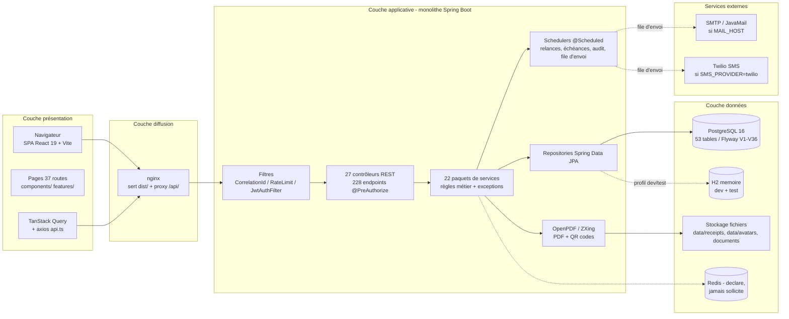

# MNK-TAX — Rapport d'analyse technique (1/3)

> **Partie 1 de 3 — Sections 1 à 5** : identité du projet, technologies, architecture, base de données, fonctionnalités.
>
> - Partie 2 : `RAPPORT_PROJET_2.md` (sections 6 à 11)
> - Partie 3 : `RAPPORT_PROJET_3.md` (sections 12 à 15, informations manquantes, annexe pour mémoire)
>
> **Règles de rédaction appliquées** : ce rapport décrit **le code tel qu'il est réellement**. Les écarts entre `docs/` et l'implémentation sont signalés explicitement. Aucun mot de passe, clé, token ou valeur de fichier `.env` n'est reproduit : seuls les **noms** de variables et des identifiants publics (ex. `admin`) apparaissent.
>
> Chiffres relevés sur le dépôt au dernier relevé : **33 commits** (HEAD `a864434`), **673 fichiers** et **170 034 lignes** hors `node_modules`/`target`/`dist`/`.git`.

---

## 1. IDENTITÉ DU PROJET

| Champ | Contenu |
|---|---|
| **Nom** | MNK-TAX |
| **Type** | Prototype académique (non officiel) d'un système de gestion fiscale malgache |
| **Dépôt** | `https://github.com/Joelito-rfa/MNK-TAX.git` (branche unique `main`) |
| **Langue de l'IHM** | Français, malgache, anglais (3 locales) |
| **Avertissement porté par le projet** | Le `README.md` précise qu'il s'agit d'une **application de démonstration à but pédagogique** : « Les données, calculs et documents ne constituent pas une source officielle de l'administration fiscale. » |

### 1.1 But de l'application

Le `README.md` et `docs/ARCHITECTURE.md` décrivent un système couvrant la chaîne fiscale complète :

**déclarations → moteur de règles → impositions (liquidation) → créances → paiements → quittances (QR + PDF) → recouvrement → notifications → audit → reporting.**

Concrètement, l'application gère :

- le registre des **contribuables** (personnes physiques/morales, NIF, régime, centre fiscal) ;
- les **déclarations** périodiques déposées par le contribuable et leur contrôle par les agents ;
- la **liquidation automatique** de l'impôt par un moteur de règles versionnées ;
- les **créances fiscales** (montant dû, pénalités et intérêts de retard) ;
- l'**encaissement** des paiements et l'émission de **quittances vérifiables** (QR code + PDF) ;
- le **recouvrement forcé** (relances, mises en demeure, litiges, échéanciers) ;
- les **contrôles fiscaux**, **réclamations** et **remboursements** ;
- la **communication multicanal** (messagerie interne, e-mail, SMS) et les notifications ;
- le **journal d'audit** et les **tableaux de bord / rapports** ;
- un **assistant conversationnel** (module `ai`).

### 1.2 Problème résolu

D'après `docs/ARCHITECTURE.md` et `docs/DATABASE.md`, le projet modélise l'ensemble du **cycle de vie d'une obligation fiscale** : d'un côté le contribuable qui dépose et paie, de l'autre l'administration qui liquide, notifie, contrôle et recouvre — le tout avec traçabilité (historiques `declaration_histories`, `assessment_history`, `debt_history`, table `audit_logs`).

### 1.3 Utilisateurs cibles (rôles réellement seedés)

Les **6 rôles** sont déclarés dans `backend/src/main/java/com/mnktax/auth/entity/Role.java` (l.32-37) et amorcés par `common/config/DemoDataSeeder.java` :

| Code du rôle | Libellé métier | Usage principal |
|---|---|---|
| `SUPER_ADMIN` | Super administrateur | Administration complète (utilisateurs, rôles, paramètres) |
| `ADMIN` | Administrateur | Administration courante, validation des demandes d'inscription |
| `TAX_AGENT` | Agent des impôts | Contribuables, déclarations, impositions, règles fiscales |
| `COLLECTION_AGENT` | Agent de recouvrement | Créances, relances, mises en demeure, échéanciers, litiges |
| `ACCOUNTANT` | Comptable | Paiements, quittances, rapports financiers |
| `TAXPAYER` | Contribuable | Déposer ses déclarations, consulter ses dettes et quittances |

> **Écart documentaire** : `docs/DATABASE.md` (§ rôles) n'en liste que **5** (il omet `ADMIN`) et le tableau des comptes de démonstration du `README.md` en montre 5 alors que le seeder en crée **6**.

**Comptes de démonstration** (identifiants publics, `DemoDataSeeder.java:474-481`) : `admin`, `agent.tax`, `agent.collection`, `accountant`, `taxpayer.demo`, `superadmin`.
> Les **mots de passe** de ces comptes sont volontairement absents de ce rapport ; ils figurent dans le `README.md` et dans `DemoDataSeeder.java` (à ne jamais réutiliser hors environnement local).

---

## 2. TECHNOLOGIES

### 2.1 Backend — `backend/pom.xml` (`com.mnktax:mnk-tax-backend:1.0.0`)

Parent `org.springframework.boot:spring-boot-starter-parent:3.3.5`, **Java 17**.

| Technologie | Version | Fichier/propriété | À quoi elle sert dans le projet |
|---|---|---|---|
| **Java** | 17 | `pom.xml` (`<java.version>`) | Langage du serveur ; records, `switch` éclair, `BigDecimal` pour les montants |
| **Spring Boot Starter Web** | 3.3.5 | parent | Serveur HTTP embarqué (Tomcat), MVC, sérialisation JSON (Jackson) |
| **Spring Boot Starter Data JPA** | 3.3.5 | parent | Couche d'accès aux données : 52 classes `@Entity`, repositories Spring Data |
| **Spring Boot Starter Security** | 3.3.5 | parent | Chaîne d'authentification JWT, RBAC par `@PreAuthorize` |
| **Spring Boot Starter Validation** | 3.3.5 | parent | Validation Bean Validation (`@Valid`, contraintes sur les DTO) |
| **Spring Boot Starter Actuator** | 3.3.5 | parent | Points de surveillance `/actuator/health`, `/actuator/info` (santé Render) |
| **Spring Boot Starter Cache** | 3.3.5 | parent | `@EnableCaching` déclaré (`MnkTaxApplication.java:10`) — **aucun `@Cacheable` utilisé** (voir §12/annexe A.8) |
| **Spring Boot Starter Data Redis** | 3.3.5 | parent | Connecteur Redis — **exclu des profils `dev`/`test`/`prod`/`render`**, actif seulement en profil `docker`, et jamais sollicité |
| **Spring Boot Starter Mail** | 3.3.5 | parent | Envoi e-mail réel via `SmtpEmailProvider` (si `MAIL_HOST` renseigné) |
| **Flyway** (`flyway-core`, `flyway-database-postgresql`) | BOM 3.3.5 | `application.yml` `spring.flyway.*` | Applique les **36 migrations** `V1`→`V36` au démarrage (`baseline-on-migrate: true`) |
| **PostgreSQL JDBC** | runtime | `pom.xml` | Driver de production (Neon PostgreSQL 16) |
| **H2** | runtime | `pom.xml` | Base **en mémoire mode PostgreSQL** pour les profils `dev` et `test` |
| **JJWT** (`jjwt-api/impl/jackson`) | 0.12.6 | `jjwt.version` | Génération et validation des jetons JWT HMAC-SHA |
| **springdoc-openapi** | 2.6.0 | `springdoc.version` | Swagger UI (`/swagger-ui.html`) documentant les 228 endpoints |
| **ZXing** (`core`, `javase`) | 3.5.3 | `zxing.version` | Génération des **QR codes** de quittance (`QrCodeService`) |
| **OpenPDF** | 1.3.40 | `openpdf.version` | Génération des **PDF** : quittance, avis d'imposition, mises en demeure |
| **Twilio SDK** | 13.0.1 | `com.twilio.sdk:twilio` | Envoi de SMS (`TwilioSmsProvider`) — **désactivé par défaut** (`SMS_PROVIDER=none`) |
| **Lombok** | version BOM | optional | Réduction du code-boilerplate (builders, getters) |
| **JUnit 5 / AssertJ / Spring Security Test** | BOM (scope `test`) | `spring-boot-starter-test` | 17 classes de test |
| **JaCoCo** | 0.8.12 | plugin Maven | Rapport de couverture (`target/site/jacoco`) |
| **Maven Wrapper** | — | `backend/mvnw`, `mvnw.cmd` | Build reproductible sans Maven installé |

### 2.2 Frontend — `frontend/package.json`

**Dépendances d'exécution (14)** :

| Dépendance | Version | Rôle dans le projet |
|---|---|---|
| `react` / `react-dom` | ^19.2.8 | Runtime d'interface (React 19) |
| `react-router-dom` | ^7.18.2 | Routage déclaratif `<BrowserRouter>` (38 routes, `src/App.tsx`) |
| `@tanstack/react-query` | ^5.101.4 | Cache et état serveur : 289 `useQuery`, 172 `useMutation` |
| `axios` | ^1.19.0 | Client HTTP unique (`src/lib/api.ts`) : jeton Bearer, refresh silencieux |
| `tailwindcss` + `@tailwindcss/vite` | ^4.3.3 | Styles utilitaires **Tailwind v4** (configuration « CSS-first » dans `src/index.css`, aucun `tailwind.config.*`) |
| `zod` | ^4.4.3 | Schémas de validation des formulaires (connexion, inscription, créances) |
| `react-hook-form` | ^7.85.0 | Gestion des formulaires (Login, Register, Taxpayers, Debts) |
| `@hookform/resolvers` | ^5.8.0 | Pont `react-hook-form` ↔ `zod` |
| `recharts` | ^3.10.1 | Graphiques `AreaChart` / `PieChart` (Dashboard, Reports) |
| `lucide-react` | ^1.31.0 | Jeu d'icônes SVG (75 fichiers) |
| `motion` | ^13.4.0 | Animations — **utilisé uniquement** dans `src/components/AiAssistant.tsx` |
| `react-markdown` | ^10.1.0 | Rendu Markdown des réponses de l'assistant |

**Dépendances de développement (12)** : `vite` ^8.2.0 (serveur dev port **5177**, proxy `/api` → `localhost:8080`), `typescript` ~6.0.2 (typage strict), `vitest` ^4.1.11 + `jsdom` ^30.0.1 (tests), `@testing-library/react` ^16.3.3 / `jest-dom` ^7.0.1 / `user-event` ^14.6.6, `@vitejs/plugin-react` ^6.0.4, `oxlint` ^1.75.0 (**linter**, remplace ESLint), `@types/*`.

> **Absents du projet** (à signaler dans le mémoire) : ESLint, i18next (i18n maison), librairie UI tierce (composants maison), librairie Excel/PDF côté client, MSW.

### 2.3 Base de données et infrastructure

| Élément | Version / valeur | Utilisation réelle |
|---|---|---|
| **PostgreSQL** | 16 | Production via **Neon** (plan Free, `docs/DEPLOYMENT-RENDER.md`) et conteneur `postgres:16-alpine` (`docker-compose.yml`) |
| **H2** | en mode PostgreSQL | Profils `dev` (défaut) et `test` : `jdbc:h2:mem:mnktax;MODE=PostgreSQL` (`application-dev.yml:6`) — **données perdues au redémarrage** |
| **Redis** | 7 (`redis:7-alpine`) | Déclaré dans `docker-compose.yml` ; **jamais utilisé** (0 `@Cacheable` dans le code, exclusion `RedisAutoConfiguration` hors profil `docker`) |
| **nginx** | 1.27-alpine | Sert le build React et **proxyfie `/api/`** vers `backend:8080` (`frontend/nginx.conf`) |
| **Serveur applicatif** | Tomcat embarqué | Spring Boot, port `8080` (`server.port`), contexte `/api` (`server.servlet.context-path`) |
| **Docker** | multi-stage | `backend/Dockerfile` (Maven → JRE 17), `frontend/Dockerfile` (Node 24 → nginx), `deploy/render/Dockerfile` (image unique) |
| **Render** | plan `free` | Hébergement des services (`render.yaml`, `deploy/render/render.yaml`) |
| **Neon** | plan `free` | PostgreSQL managé branché par le profil `prod` via `DATABASE_URL` (`RenderDataSourceConfig.java`) |

### 2.4 Outils de build et de qualité

| Outil | Commande | Rôle |
|---|---|---|
| Maven Wrapper | `cd backend && ./mvnw test` / `./mvnw package -DskipTests` | Compilation, tests, paquetage (`finalName` = `mnk-tax`) |
| Vite | `npm run dev` / `npm run build` (`tsc -b && vite build`) | Serveur de développement et build de production |
| Vitest | `npm run test` (`vitest run`) | Tests frontend (jsdom) |
| oxlint | `npm run lint` | Lint (`frontend/.oxlintrc.json`) |
| JaCoCo | phase `test` Maven | Couverture de code |
| Swagger UI | `/swagger-ui.html` | Exploration de l'API (désactivable via `EXPOSE_API_DOCS`) |

---

## 3. ARCHITECTURE

### 3.1 Arborescence du dépôt (profondeur 3)

```
MNK-TAX/
├── README.md                 Présentation, démarrage rapide, comptes de démo
├── .env.example              Template des variables d'environnement (30 noms)
├── docker-compose.yml        Orchestration : postgres, redis, backend, frontend
├── render.yaml               Blueprint Render : 2 services (API web + frontend statique)
├── backend/
│   ├── pom.xml               Dépendances et plugins Maven
│   ├── mvnw, mvnw.cmd, .mvn/ Wrapper Maven
│   ├── Dockerfile            Image multi-stage Maven → eclipse-temurin:17-jre
│   ├── data/                 Fichiers générés : receipts/ (QR PNG), avatars/
│   └── src/
│       ├── main/
│       │   ├── java/com/mnktax/   Code applicatif (279 fichiers, 22 paquets)
│       │   └── resources/         application*.yml (6 profils) + db/migration/ (36 SQL)
│       └── test/java/com/mnktax/  17 classes de test
├── frontend/
│   ├── package.json          Dépendances et scripts
│   ├── vite.config.ts        Dev server (port 5177) + proxy /api
│   ├── vitest.config.ts      Tests (jsdom)
│   ├── Dockerfile            Image multi-stage Node → nginx
│   ├── nginx.conf            Serveur de production + proxy /api/ → backend:8080
│   ├── public/               Assets statiques (hero/)
│   └── src/                  Application React (162 fichiers)
│       ├── App.tsx           Définition des routes
│       ├── main.tsx          createRoot + QueryClientProvider
│       ├── components/       Composants transverses (dont collection/, communication/, landing/)
│       ├── features/         12 modules métier (api/, components/, hooks/)
│       ├── lib/              api.ts, auth.tsx, i18n.tsx, theme.tsx, exporters.ts
│       ├── locales/          fr.ts, en.ts, mg.ts (1 600 clés chacun)
│       ├── pages/            37 pages routées
│       └── types/index.ts    138 types partagés
├── docs/                     Documentation (ARCHITECTURE, API, DATABASE, SECURITY, DEPLOYMENT…)
├── deploy/render/            Dockerfile unique, nginx.template, start.sh, render.yaml, smoke-test.ps1
└── infra/nginx/              Répertoire vide (aucun fichier)
```

### 3.2 Pattern utilisé

Le projet n'est **pas un MVC classique** : c'est un **monolithe applicatif modulaire** exposant une **API REST**, consommée par une **SPA** (architecture **3 tiers**).

1. **Côté serveur** : découpage **vertical par domaine** (« slices ») — chaque paquet `com.mnktax.<domaine>` regroupe `controller/`, `service/`, `repository/`, `entity/`, `dto/` :
   - `controller` = couche web (endpoints REST, `@PreAuthorize`) ;
   - `service` = logique métier (transactions, règles, exceptions métier) ;
   - `repository` = accès données Spring Data JPA ;
   - `entity` = modèle persistant (JPA) ;
   - `dto` = contrats d'entrée/sortie (séparation entité/DTO).
2. **Transverse** : `common/` (config, exceptions, schedulers, utilitaires, validation, filtres web), `auth/security/` (chaîne JWT).
3. **Côté client** : SPA React avec couche API typée (`features/<domaine>/api/{keys,queries,mutations}.ts`) et TanStack Query comme cache d'état serveur.
4. **Persistance** : JPA/Hibernate (`ddl-auto: validate`) + **Flyway** pour le schéma (le schéma n'est jamais généré par Hibernate).

### 3.3 Flux d'une requête type

Exemple : *un agent des impôts consulte la liste des contribuables*.

1. **IHM** : `frontend/src/pages/Taxpayers.tsx` → hook `useTaxpayers()` (`features/taxpayer/api/queries.ts`) → `apiGet('/taxpayers')`.
2. **Client HTTP** : `src/lib/api.ts` ajoute `Authorization: Bearer <accessToken>` et l'en-tête `Accept-Language` (`fr-MG`/`mg-MG`/`en-US`).
3. **Proxy** : en production, nginx (`frontend/nginx.conf`) route `/api/` vers `backend:8080` ; en dev, le proxy Vite (`vite.config.ts`) fait de même vers `localhost:8080`.
4. **Filtres backend** (`securityFilterChain` + `WebConfig`) : `CorrelationIdFilter` (en-tête `X-Correlation-Id`) → `RateLimitInterceptor` (fenêtre de 60 s) → `JwtAuthFilter` (lit le JWT, charge l'utilisateur, remplit le `SecurityContextHolder`).
5. **Contrôleur** : `TaxpayerController.list()` annoté `@PreAuthorize("hasAuthority('PERMISSION_TAXPAYER_READ')")` — `@EnableMethodSecurity` applique le RBAC.
6. **Service** : `TaxpayerService.search(...)` (filtres, pagination).
7. **Repository** : `TaxpayerRepository` (Spring Data JPA) → requête SQL via Hibernate → **PostgreSQL 16** (prod/docker) ou **H2** (dev).
8. **Réponse** : DTO paginé `Page<T>` → JSON → intercepteur axios → cache TanStack Query → rendu React.

### 3.4 Schéma d'architecture



### 3.5 Conventions techniques (vérifiées dans le code)

| Convention | Où | Constat |
|---|---|---|
| `spring.jpa.open-in-view: false` | `application.yml` | Respecté (pas de lazy-loading dans la vue) |
| `spring.jpa.hibernate.ddl-auto: validate` | `application.yml` | Le schéma vient **uniquement** de Flyway |
| Montants en `BigDecimal` | entités + `TaxCalculator` | Arrondi `HALF_UP` à 2 décimales |
| Autorités Spring `PERMISSION_*` | `auth/security/Permissions.java` | 90 constantes ; contrôleurs testent `hasAuthority('PERMISSION_…')` |
| Erreurs métier JSON | `common/exception/GlobalExceptionHandler.java` | Codes métier (`INVALID_BASE`, `DEBT_TRANSITION_INVALID`…) + `ApiError` 401/403/404 |
| Traçabilité | `audit/service/AuditService` + historiques métier | Écritures dans `audit_logs`, `declaration_histories`, `assessment_history`, `debt_history` |

---

## 4. BASE DE DONNÉES

### 4.1 Vue d'ensemble

| Caractéristique | Valeur mesurée |
|---|---|
| **Moteur** | PostgreSQL 16 (prod `prod`/`render`/`docker`, Neon), **H2 en mode PostgreSQL** (profils `dev`/`test`) |
| **Gestion du schéma** | **Flyway** (`spring.flyway.baseline-on-migrate: true`) — Hibernate en `ddl-auto: validate` ne fait que **vérifier** |
| **Fichiers de migration** | **36** (`V1` → `V36`), `backend/src/main/resources/db/migration/` |
| **Tables** | **53** `CREATE TABLE` au total |
| **Entités JPA** | **52** fichiers `@Entity` dont **51** portent `@Table(name = …)` |
| **Contraintes de clé étrangère** | **80** occurrences `REFERENCES` |
| **Index** | **126** `CREATE INDEX` / `CREATE UNIQUE INDEX` |
| **Gestion des versions d'entités** | `@Version` (optimiste) sur les entités sensibles : `declarations`, `assessments`, `tax_debts`, `payments`, `taxpayers`, `users`, `tax_controls`, `complaints`, `refunds`… |

> **Important** : il **n'existe pas de script SQL unique** de création de la base (`CREATE_DATABASE.sql`, `schema.sql` : **NON TROUVÉ**). Le schéma résulte de l'**empilement des 36 migrations Flyway** ; le script du socle `V1__initial_schema.sql` est reproduit intégralement au §4.6 et le récapitulatif des 36 fichiers au §4.2.

### 4.2 Inventaire des migrations Flyway

| # Fichier | Lignes | Objet |
|---|---:|---|
| `V1__initial_schema.sql` | 151 | Socle sécurité (`roles`, `permissions`, `role_permissions`, `users`, `user_roles`, `refresh_tokens`) + référentiel (`tax_centers`, `tax_regimes`, `taxpayers`, `taxpayer_addresses`, `taxpayer_activities`, `tax_types`, `tax_obligations`) |
| `V2__create_tax_rules.sql` | 50 | Règles fiscales + versions de règles |
| `V3__create_declaration_assessment.sql` | 68 | Déclarations, lignes de déclaration, impositions, lignes d'imposition |
| `V4__create_debt_collection.sql` | 85 | Créances, composantes, actions de recouvrement, avis |
| `V5__create_payment_receipt.sql` | 54 | Paiements, imputations, quittances |
| `V6__create_auxiliary.sql` | 57 | Notifications, documents, pénalités, intérêts, `audit_logs`, `system_parameters`, échéances |
| `V7__create_messages.sql` | 17 | Messagerie interne |
| `V8__update_collection_actions.sql` | 5 | Prochaine action / date de prochaine action |
| `V9__add_tax_rule_brackets.sql` | 2 | Tranches progressives (`brackets` JSON) |
| `V10__extend_declarations.sql` | 53 | Exercice, régime, taux, pénalités, montants, échéance, déclaration rectificative, centre fiscal |
| `V11__add_user_avatar.sql` | 4 | `users.avatar_path` |
| `V12__upgrade_messages.sql` | 39 | Contexte métier du message (fil, `taxpayer_id`, `declaration_id`, `debt_id`, priorité, `processing_status`) |
| `V13__extend_taxpayer_identity.sql` | 6 | `birth_date`, `legal_representative`, `registration_date` |
| `V14__create_control_complaint_refund.sql` | 101 | Contrôle fiscal, pièces, réclamations, réponses, remboursements |
| `V15__upgrade_debts.sql` | 29 | Origine, priorité de recouvrement, observations, historique de créance |
| `V16__enrich_regime_obligation.sql` | 19 | TVA applicable, périodicité, calendrier et statuts d'obligation |
| `V17__add_user_id_to_taxpayer.sql` | 4 | Lien `taxpayers.user_id` → `users` (compte « espace contribuable ») |
| `V18__enrich_payments.sql` | 15 | Lien créance/déclaration, devise `MGA`, référence de transaction, montant non réglé |
| `V19__upgrade_receipts.sql` | 52 | Jeton de vérification, PDF, annulation/remplacement, permissions de consultation |
| `V20__optimize_message_search_indexes.sql` | 17 | Index de recherche plein texte des messages |
| `V21__add_missing_permissions.sql` | 47 | ~34 permissions manquantes (rôle `ACCOUNTANT`, historiques, exports) |
| `V22__allow_multiple_receipts_per_payment.sql` | 18 | 1 paiement → N quittances (un paiement partiel par créance) |
| `V23__create_registration_requests.sql` | 14 | Demandes d'inscription |
| `V24__upgrade_registration_requests.sql` | 27 | Référence, type de demande, identité du demandeur, rejet |
| `V25__upgrade_profile_module.sql` | 7 | Métadonnées de connexion (`last_login_ip`, `job_title`, `tax_center`) |
| `V26__allow_manual_debts.sql` | 7 | `assessment_id` et `tax_type_id` deviennent facultatifs (créance manuelle) |
| `V27__create_payment_plans.sql` | 37 | Échéanciers + échéances |
| `V28__create_debt_disputes.sql` | 27 | Litiges sur créance |
| `V29__communication_lifecycle.sql` | 48 | Cycle de vie des livraisons (tentatives, `next_retry_at`, statuts) |
| `V30__communication_center.sql` | 235 | Centre de communication : modèles trilingues, campagnes, destinataires, règles d'événements |
| `V31__overdue_collection_auto_messages.sql` | 109 | Messages automatiques de créances échues |
| `V32__installment_overdue_auto_messages.sql` | 147 | Messages automatiques d'échéances impayées |
| `V33__message_external_recipient.sql` | 7 | Destinataire externe (`recipient_email`, `recipient_label`) |
| `V34__assessment_lifecycle.sql` | 32 | Cycle de vie des impositions (statut, origine, exonération, imposition parente) |
| `V35__assessment_write_role.sql` | 8 | Permission d'écriture des impositions pour l'agent |
| `V36__deadline_reminder_rules.sql` | 60 | Corps SMS rendu + modèle de rappel d'échéance + paliers J-7/J-3/J-1/J-0 |

### 4.3 Schéma reconstitué — les 53 tables

> Les colonnes indiquées sont celles du `CREATE TABLE` initial **augmentées des `ALTER TABLE`** des migrations ultérieures (l'ensemble a été reconstitué en lisant les 36 fichiers SQL). Types simplifiés : `BIGINT PK` = `BIGSERIAL PRIMARY KEY`.

#### A. Sécurité et annuaire (6 tables)

- **`roles`** : `id PK`, `code VARCHAR(40) UNIQUE`, `name`, `description`, `is_system BOOL DEFAULT FALSE`.
- **`permissions`** : `id PK`, `code VARCHAR(80) UNIQUE`, `name VARCHAR(120)`, `description`.
- **`role_permissions`** : `role_id FK→roles (CASCADE)`, `permission_id FK→permissions (CASCADE)`, `UNIQUE(role_id, permission_id)` — table d'association.
- **`users`** : `id PK`, `username UNIQUE`, `email UNIQUE`, `password`, `first_name`, `last_name`, `phone`, `enabled`, `must_change_password`, `mfa_enabled`, `last_login_at`, `created_at`, `updated_at`, `version` ; + `avatar_path` (V11), `job_title`, `tax_center`, `last_login_ip`, `last_login_user_agent` (V25).
- **`user_roles`** : `user_id FK→users`, `role_id FK→roles`, `UNIQUE(user_id, role_id)`.
- **`refresh_tokens`** : `id PK`, `token UNIQUE`, `expires_at`, `revoked`, `created_at`, `user_id FK→users` ; + `user_agent`, `ip_address` (V25).

#### B. Contribuables et référentiel territorial (5 tables)

- **`taxpayers`** : `id PK`, **`nif VARCHAR(10) UNIQUE`**, `type`, `name`, `business_name`, `first_name`, `last_name`, `phone`, `email`, `address`, `tax_center_id FK→tax_centers`, `tax_regime_id FK→tax_regimes`, `status DEFAULT 'ACTIVE'`, `created_at`, `updated_at`, `version` ; + `birth_date`, `legal_representative`, `registration_date` (V13), **`user_id FK→users`** (V17, liaison au compte), `language`, `preferred_channels`, `phone_normalized` (V30).
- **`taxpayer_addresses`** : `id PK`, `taxpayer_id FK→taxpayers (CASCADE)`, `type`, `address_line1`, `address_line2`, `city`, `region`, `country`, `postal_code`.
- **`taxpayer_activities`** : `id PK`, `taxpayer_id FK→taxpayers (CASCADE)`, `code`, `label`, `description`, `is_primary`.
- **`tax_centers`** : `id PK`, `code UNIQUE`, `name`, `address`, `created_at`.
- **`tax_regimes`** : `id PK`, `code UNIQUE`, `name`, `description`, `category` ; + `vat_applicable`, `obligation_periodicity`, `applicable_tax_types` (V16).

#### C. Fiscalité : types, obligations, calendrier (3 tables)

- **`tax_types`** : `id PK`, `code UNIQUE`, `name`, `category`, `description`, `is_active`.
- **`tax_obligations`** : `id PK`, `taxpayer_id FK→taxpayers`, `tax_type_id FK→tax_types`, `periodicity`, `start_date`, `end_date`, `status DEFAULT 'ACTIVE'`, `created_at` ; + `tax_regime_id FK`, `tax_center_id FK`, `period`, `declaration_deadline`, `payment_deadline`, `expected_amount`, `declaration_status DEFAULT 'NOT_SUBMITTED'`, `payment_status DEFAULT 'UNPAID'`, `updated_at` (V16).
- **`deadlines`** : `id PK`, `tax_type_id FK→tax_types`, `period`, `declaration_deadline`, `payment_deadline`, `created_at` — alimente les rappels J-x (V36).

#### D. Règles de calcul (2 tables)

- **`tax_rules`** : `id PK`, `code UNIQUE`, `name`, `tax_type_id FK→tax_types`, `taxpayer_type`, `regime_id FK→tax_regimes`, `activity_code`, `calculation_method` (`FLAT_RATE`/`PERCENTAGE_OF_BASE`/`PROGRESSIVE`/`PER_UNIT`), `rate NUMERIC(19,6)`, `minimum`, `maximum`, `deduction`, `exemption`, `legal_reference`, **`is_demo DEFAULT TRUE`**, `effective_from`, `effective_to`, `is_active`, `created_at`, `created_by` ; + `brackets TEXT` (V9, tranches JSON pour le barème progressif).
- **`tax_rule_versions`** : `id PK`, `rule_id FK→tax_rules (CASCADE)`, `version_number`, `snapshot TEXT`, `reason`, `changed_by`, `created_at` — versionnage/audit des règles.

#### E. Déclarations (4 tables)

- **`declarations`** : `id PK`, `reference`, `taxpayer_id FK→taxpayers`, `tax_type_id FK→tax_types`, `period`, `submission_date`, `status DEFAULT 'DRAFT'`, `tax_base`, `declared_amount`, `calculated_tax`, `submitted_by`, `submitted_at`, `validated_by`, `validated_at`, `validation_comment`, `created_at`, `updated_at`, `version` ; + `exercice`, `regime`, `taux`, `penalites`, `total_a_payer`, `montant_paye`, `reste_a_payer`, `date_echeance`, `rectificative`, `declaration_origine_id`, `motif_correction`, `tax_center_id`, `due_date` (V10).
- **`declaration_lines`** : `id PK`, `declaration_id FK→declarations (CASCADE)`, `line_number`, `label`, `amount`.
- **`declaration_annexes`** : `id PK`, `declaration_id FK (CASCADE)`, `nom`, `fichier`, `type_mime`, `taille`, `categorie`, `obligatoire`, `uploaded_by`, `created_at` (V10).
- **`declaration_histories`** : `id PK`, `declaration_id FK (CASCADE)`, `user_id`, `username`, `action`, `ancien_statut`, `nouveau_statut`, `commentaire`, `anciennes_donnees`, `nouvelles_donnees`, `created_at` (V10) — traçabilité du cycle de vie.

#### F. Impositions et paramètres de calcul (5 tables)

- **`assessments`** : `id PK`, `reference`, `declaration_id FK→declarations (UNIQUE, nullable depuis V34)`, `taxpayer_id FK`, `tax_type_id FK`, `period`, `tax_base`, `gross_tax`, `deduction`, `credit`, `adjustment`, `net_tax`, `calculation_date`, `rule_code`, `rule_version`, `computed_by`, `created_at`, `version` ; + `status DEFAULT 'EMISED'`, `origin DEFAULT 'DECLARATIVE'` (`DECLARATIVE`/`RECTIFICATIVE`/`REDRESSEMENT`/`OFFICE`), `exemption`, `parent_id FK→assessments`, `notified_at`, `cancelled_at`, `observations` (V34).
- **`assessment_lines`** : `id PK`, `assessment_id FK (CASCADE)`, `line_number`, `label`, `base_amount`, `rate`, `calculated_amount`.
- **`assessment_history`** : `id PK`, `assessment_id FK (CASCADE)`, `username`, `action`, `old_value`, `new_value`, `commentaire`, `created_at` (V34).
- **`penalties`** : `id PK`, `code UNIQUE`, `name`, `rate NUMERIC(19,6)`, `min_amount`, `max_amount`, `description` (V6).
- **`interests`** : `id PK`, `code UNIQUE`, `name`, `rate`, `periodicity`, `description` (V6).

#### G. Créances et recouvrement (8 tables)

- **`tax_debts`** : `id PK`, `reference`, `taxpayer_id FK`, `assessment_id FK (nullable depuis V26)`, `tax_type_id FK (nullable depuis V26)`, `period`, `principal_amount`, `penalty_amount`, `interest_amount`, `adjustments_amount`, `credits_amount`, `total_amount`, `paid_amount`, `balance`, `issue_date`, `due_date`, `status DEFAULT 'ISSUED'`, `closed_at`, `created_at`, `updated_at`, `version` ; + `origin`, `collection_priority`, `observations`, `created_by`, `last_due_date`, `suspended_at`, `taxpayer_center` (V15).
- **`debt_items`** : `id PK`, `debt_id FK (CASCADE)`, `kind`, `label`, `amount`, `created_at` — détail ligne à ligne d'une créance.
- **`debt_history`** : `id PK`, `debt_id FK (CASCADE)`, `event_type`, `description`, `old_value`, `new_value`, `performed_by`, `event_date`, `created_at` (V15).
- **`collection_actions`** : `id PK`, `debt_id FK (CASCADE)`, `type`, `description`, `action_date`, `outcome`, `responsible_user_id FK→users`, `status DEFAULT 'PLANNED'`, `created_at` ; + `next_action`, `next_action_date` (V8).
- **`collection_notices`** : `id PK`, `debt_id FK (CASCADE)`, `notice_number`, `notice_date`, `notice_type`, `content`, `sent_at`, `status DEFAULT 'DRAFT'`, `created_at`.
- **`payment_plans`** : `id PK`, `reference`, `debt_id FK (CASCADE)`, `label`, `total_amount`, `status DEFAULT 'ACTIVE'`, `notes`, `created_by`, `created_at`, `updated_at` (V27).
- **`payment_plan_installments`** : `id PK`, `plan_id FK (CASCADE)`, `installment_number`, `due_date`, `amount`, `paid_amount`, `status DEFAULT 'PENDING'`, `paid_at`, `created_at`, `updated_at` (V27).
- **`debt_disputes`** : `id PK`, `reference`, `debt_id FK (CASCADE)`, `reason`, `contested_amount`, `contestation_date`, `status DEFAULT 'OPEN'`, `decision` (`SUSTAINED`/`REJECTED`/`WITHDRAWN`), `decision_notes`, `decided_by`, `decided_at`, `created_by`, `created_at`, `updated_at` (V28).

#### H. Paiements, quittances, remboursements (4 tables)

- **`payments`** : `id PK`, `reference`, `taxpayer_id FK`, `payment_date`, `amount`, `method`, `status DEFAULT 'RECORDED'`, `allocated_amount`, `rejection_reason`, `created_by`, `recorded_at`, `created_at`, `updated_at`, `version` ; + `debt_id FK`, `declaration_id FK`, `currency DEFAULT 'MGA'`, `transaction_reference`, `unpaid_amount`, `observations` (V18).
- **`payment_allocations`** : `id PK`, `payment_id FK (CASCADE)`, `debt_id FK→tax_debts`, `amount`, `component`, `allocated_at`, `created_by` ; + `comment` (V18) — ventilation d'un paiement sur plusieurs créances.
- **`receipts`** : `id PK`, `reference`, `payment_id FK`, `receipt_number`, `taxpayer_id FK`, `tax_type_id FK`, `period`, `amount`, `method`, `status DEFAULT 'ISSUED'`, `qr_code_path`, `issued_at`, `verified_at`, `created_at` ; + `verification_token UNIQUE NOT NULL`, `declaration_id`, `debt_id`, `currency`, `transaction_reference`, `payment_date`, `center_code`, `pdf_path`, `download_count`, `created_by`, `updated_at`, `cancelled_reason/by/at`, `replaced_by_reference`, `replaced_at`, `refund_reference` (V19) — la contrainte `UNIQUE(payment_id)` de V5 est **supprimée en V22**.
- **`refunds`** : `id PK`, `reference UNIQUE`, `taxpayer_id FK`, `debt_id`, `declaration_id`, `reason`, `description`, `amount`, `status DEFAULT 'PENDING'`, `requested_by`, `reviewed_by`, `reviewed_at`, `approved_amount`, `payment_method`, `payment_reference`, `paid_at`, `rejection_reason`, `created_at`, `updated_at`, `version` (V14).

#### I. Contrôle fiscal et réclamations (4 tables)

- **`tax_controls`** : `id PK`, `reference UNIQUE`, `taxpayer_id FK`, `agent_id FK→users`, `control_type`, `period_start`, `period_end`, `reason`, `status DEFAULT 'OPEN'`, `started_at`, `completed_at`, `observations`, `anomalies`, `redressement`, `penalty_amount`, `debt_id FK→tax_debts`, `created_at`, `updated_at`, `version` (V14).
- **`control_documents`** : `id PK`, `control_id FK (CASCADE)`, `title`, `document_type`, `requested`, `received`, `notes`, `created_at` (V14).
- **`complaints`** : `id PK`, `reference UNIQUE`, `taxpayer_id FK`, `subject`, `description`, `context_type`, `context_ref`, `declaration_id`, `debt_id`, `payment_id`, `control_id`, `refund_id`, `status DEFAULT 'OPEN'`, `assigned_to FK→users`, `resolution`, `resolved_at`, `closed_at`, `created_at`, `updated_at`, `version` (V14).
- **`complaint_responses`** : `id PK`, `complaint_id FK (CASCADE)`, `author_id FK→users`, `author_name`, `content`, `created_at` (V14).

#### J. Communication et notifications (8 tables)

- **`messages`** : `id PK`, `sender_id FK→users (SET NULL)`, `sender_name`, `recipient_id FK→users (CASCADE)`, `subject`, `content`, `is_read`, `read_at`, `created_at` (V7) ; + `thread_id`, `context_type`, `context_ref`, `taxpayer_id`, `declaration_id`, `debt_id`, `payment_id`, `priority`, `processing_status`, `closed_at`, `archived_at`, `updated_at` (V12) ; + `status`, `scheduled_at`, `created_by` (V30), `channels`, `message_type`, `template_code`, `campaign_id`, `last_error` (V31), `recipient_email`, `recipient_label` (V33), **`sms_content`** (V36).
- **`message_attachments`** : `id PK`, `message_id FK (CASCADE)`, `file_name`, `original_name`, `mime_type`, `size`, `uploaded_by`, `created_at` (V12).
- **`message_deliveries`** : `id PK`, `message_id FK (CASCADE)`, `channel` (`IN_APP`/`EMAIL`/`SMS`), `recipient_address`, `status`, `attempt_count`, `max_attempts`, `last_error`, `next_retry_at`, `provider_message_id`, `sent_at`, `delivered_at`, `read_at`, `created_at`, `updated_at` (V29) — file d'envoi avec relances.
- **`message_templates`** : `id PK`, `code`, `category`, `channels`, `subject_fr/mg/en`, `body_fr/mg/en`, `sms_body_fr/mg/en`, `enabled`, `created_at`, `updated_at` (V30, V36).
- **`campaigns`** : `id PK`, `reference`, `name`, `audience`, `audience_filter`, `channels`, `created_by`, `created_by_name`, `recipient_count`, `sent_count`, `failed_count`, `read_count`, `status DEFAULT 'QUEUED'`, `created_at`, `updated_at` (V30).
- **`campaign_recipients`** : `id PK`, `campaign_id FK (CASCADE)`, `taxpayer_id`, `user_id`, `status DEFAULT 'PENDING'`, `created_at` (V30).
- **`communication_event_rules`** : `id PK`, `event_type`, `template_code`, `channels`, `priority`, `day_offset`, `enabled`, `created_at`, `updated_at` (V30, V31, V32, V36) — déclencheurs automatiques (créance échue, échéance J-x…).
- **`notifications`** : `id PK`, `user_id FK→users (CASCADE)`, `type`, `title`, `message`, `entity_type`, `entity_id`, `is_read`, `read_at`, `created_at` (V6).

#### K. Transverse (4 tables)

- **`documents`** : `id PK`, `taxpayer_id FK (CASCADE)`, `title`, `document_type`, `file_path`, `mime_type`, `size`, `uploaded_by`, `created_at` (V6).
- **`audit_logs`** : `id PK`, `user_id` (**sans clé étrangère**), `username`, `action`, `entity_type`, `entity_id`, `old_value`, `new_value`, `ip_address`, `user_agent`, `created_at` (V6).
- **`system_parameters`** : `id PK`, `param_key`, `param_value`, `description`, `category`, `updated_at` (V6) — ex. `VAT_RATE`, `PENALTY_RATE`, `INTEREST_RATE_MONTHLY`.
- **`registration_requests`** : `id PK`, `name`, `email`, `organization`, `role`, `message`, `status DEFAULT 'PENDING'`, `reviewed_by`, `reviewed_at`, `created_at` (V23) ; + `reference UNIQUE`, `request_type`, `first_name`, `last_name`, `phone`, `nif`, `address`, `position`, `tax_center`, `rejection_reason`, `assigned_to`, `assigned_at`, `updated_at` (V24).

### 4.4 Relations et cardinalités (principales)

| Relation | Cardinalité | Commentaire |
|---|---|---|
| `users` ↔ `roles` | N ↔ N via `user_roles` | Rôle multi-applications |
| `roles` ↔ `permissions` | N ↔ N via `role_permissions` | RBAC |
| `tax_centers` → `taxpayers` | 1 ↔ N | Centre fiscal de rattachement |
| `tax_regimes` → `taxpayers` | 1 ↔ N | Régime fiscal |
| `taxpayers` → `declarations`, `tax_debts`, `payments`, `receipts`, `documents`, `tax_controls`, `complaints`, `refunds` | 1 ↔ N | Tout le cycle est indexé sur le contribuable |
| `users` ↔ `taxpayers` | 0..1 ↔ 1 (`taxpayers.user_id`) | Espace contribuable |
| `tax_types` → `declarations`, `assessments`, `tax_debts`, `receipts`, `tax_obligations`, `deadlines`, `tax_rules` | 1 ↔ N | Nature d'impôt partout |
| `declarations` → `assessments` | 1 ↔ 0..1 (`UNIQUE(declaration_id)`) | Une déclaration validée donne une imposition |
| `declarations` → `declaration_lines` / `_annexes` / `_histories` | 1 ↔ N (CASCADE) | |
| `assessments` → `assessment_lines` / `assessment_history` | 1 ↔ N (CASCADE) | |
| `assessments` → `tax_debts` | 1 ↔ 1 (ou 1 ↔ N) | Créance émise à partir de l'imposition (OU créance manuelle sans imposition, V26) |
| `tax_debts` → `debt_items`, `debt_history`, `collection_actions`, `collection_notices`, `payment_plans`, `debt_disputes`, `payment_allocations` | 1 ↔ N (CASCADE) | |
| `payments` → `payment_allocations` → `tax_debts` | 1 ↔ N ; N ↔ 1 | Imputation sur une ou plusieurs créances |
| `payments` → `receipts` | 1 ↔ N (depuis V22) | Justificatifs multiples |
| `complaints` → `complaint_responses` | 1 ↔ N (CASCADE) | |
| `payment_plans` → `payment_plan_installments` | 1 ↔ N (CASCADE) | |
| `messages` → `message_attachments`, `message_deliveries` | 1 ↔ N (CASCADE) | Multi-canal avec retries |
| `campaigns` → `campaign_recipients` | 1 ↔ N (CASCADE) | |
| `users` → `notifications`, `refresh_tokens` | 1 ↔ N (CASCADE) | |
| `tax_controls` → `tax_debts` | N ↔ 0..1 | Redressement génère une créance |
| `audit_logs`, `system_parameters`, `penalties`, `interests` | **sans clé étrangère** | Référentiels autonomes (à signaler : `audit_logs.user_id` non référencé) |

### 4.5 Modèle relationnel (ERD)

```mermaid
erDiagram
    users ||--o{ user_roles : "a"
    roles ||--o{ user_roles : "a"
    roles ||--o{ role_permissions : "octroie"
    permissions ||--o{ role_permissions : "est dans"
    users ||--o{ refresh_tokens : "possède"
    users ||--o{ notifications : "reçoit"
    users ||--o{ messages : "reçoit"
    users ||--o{ collection_actions : "réalise"

    tax_centers ||--o{ taxpayers : "rattache"
    tax_regimes ||--o{ taxpayers : "classe"
    taxpayers ||--o{ taxpayer_addresses : "habite"
    taxpayers ||--o{ taxpayer_activities : "exerce"
    taxpayers ||--o{ tax_obligations : "est tenu de"
    taxpayers ||--o{ declarations : "dépose"
    taxpayers ||--o{ tax_debts : "doit"
    taxpayers ||--o{ payments : "paie"
    taxpayers ||--o{ receipts : "obtient"
    taxpayers ||--o{ tax_controls : "est contrôlé"
    taxpayers ||--o{ complaints : "saisit"
    taxpayers ||--o{ refunds : "demande"
    taxpayers ||--o{ documents : "fournit"

    tax_types ||--o{ tax_obligations : "concerne"
    tax_types ||--o{ deadlines : "échéance"
    tax_types ||--o{ tax_rules : "régit"
    tax_regimes ||--o{ tax_rules : "cible"
    tax_rules ||--o{ tax_rule_versions : "versionne"

    tax_types ||--o{ declarations : "concerne"
    declarations ||--o{ declaration_lines : "détaille"
    declarations ||--o{ declaration_annexes : "joint"
    declarations ||--o{ declaration_histories : "tracé par"
    declarations ||--o| assessments : "liquidée en"
    assessments ||--o{ assessment_lines : "détaille"
    assessments ||--o{ assessment_history : "tracé par"
    assessments ||--o{ tax_debts : "génère"
    assessments ||--o| assessments : "rectifie"

    tax_debts ||--o{ debt_items : "se décompose en"
    tax_debts ||--o{ debt_history : "tracé par"
    tax_debts ||--o{ collection_actions : "relancé par"
    tax_debts ||--o{ collection_notices : "notifié par"
    tax_debts ||--o{ payment_plans : "échelonné par"
    tax_debts ||--o{ debt_disputes : "contesté par"
    tax_debts ||--o{ payment_allocations : "solde par"
    payment_plans ||--o{ payment_plan_installments : "découpe en"
    payments ||--o{ payment_allocations : "impute"
    payments ||--o{ receipts : "justifié par"
    complaints ||--o{ complaint_responses : "répondu par"
    tax_controls ||--o{ control_documents : "demande"
    messages ||--o{ message_attachments : "contient"
    messages ||--o{ message_deliveries : "acheminé via"
    campaigns ||--o{ campaign_recipients : "vise"
```



### 4.6 Script SQL de création (socle `V1__initial_schema.sql`, intégral)

```sql
-- ============================================================
-- MNK-TAX - Prototype académique - Schéma initial
-- V1 : sécurité (rôles, permissions, utilisateurs) + contribuables
-- ============================================================

CREATE TABLE roles (
    id          BIGSERIAL PRIMARY KEY,
    code        VARCHAR(40)  NOT NULL,
    name        VARCHAR(80)  NOT NULL,
    description VARCHAR(255),
    is_system   BOOLEAN      NOT NULL DEFAULT FALSE,
    CONSTRAINT uk_role_code UNIQUE (code)
);

CREATE TABLE permissions (
    id          BIGSERIAL PRIMARY KEY,
    code        VARCHAR(80) NOT NULL,
    name        VARCHAR(120) NOT NULL,
    description VARCHAR(255),
    CONSTRAINT uk_permission_code UNIQUE (code)
);

CREATE TABLE role_permissions (
    role_id       BIGINT NOT NULL REFERENCES roles (id) ON DELETE CASCADE,
    permission_id BIGINT NOT NULL REFERENCES permissions (id) ON DELETE CASCADE,
    CONSTRAINT uk_role_permission UNIQUE (role_id, permission_id)
);

CREATE TABLE users (
    id                   BIGSERIAL PRIMARY KEY,
    username             VARCHAR(50)  NOT NULL,
    email                VARCHAR(120) NOT NULL,
    password             VARCHAR(255) NOT NULL,
    first_name           VARCHAR(80),
    last_name            VARCHAR(80),
    phone                VARCHAR(30),
    enabled              BOOLEAN      NOT NULL DEFAULT TRUE,
    must_change_password BOOLEAN      NOT NULL DEFAULT FALSE,
    mfa_enabled          BOOLEAN      NOT NULL DEFAULT FALSE,
    last_login_at        TIMESTAMP,
    created_at           TIMESTAMP    NOT NULL,
    updated_at           TIMESTAMP    NOT NULL,
    version              BIGINT,
    CONSTRAINT uk_user_username UNIQUE (username),
    CONSTRAINT uk_user_email UNIQUE (email)
);
CREATE INDEX idx_user_email ON users (email);
CREATE INDEX idx_user_status ON users (enabled);

CREATE TABLE user_roles (
    user_id BIGINT NOT NULL REFERENCES users (id) ON DELETE CASCADE,
    role_id BIGINT NOT NULL REFERENCES roles (id) ON DELETE CASCADE,
    CONSTRAINT uk_user_role UNIQUE (user_id, role_id)
);

CREATE TABLE refresh_tokens (
    id         BIGSERIAL PRIMARY KEY,
    user_id    BIGINT       NOT NULL REFERENCES users (id) ON DELETE CASCADE,
    token      VARCHAR(255) NOT NULL,
    expires_at TIMESTAMP    NOT NULL,
    revoked    BOOLEAN      NOT NULL DEFAULT FALSE,
    created_at TIMESTAMP    NOT NULL,
    CONSTRAINT uk_refresh_token UNIQUE (token)
);
CREATE INDEX idx_refresh_token_user ON refresh_tokens (user_id);
CREATE INDEX idx_refresh_token_expiry ON refresh_tokens (expires_at);

CREATE TABLE tax_centers (
    id         BIGSERIAL PRIMARY KEY,
    code       VARCHAR(20)  NOT NULL,
    name       VARCHAR(120) NOT NULL,
    address    VARCHAR(255),
    created_at TIMESTAMP    NOT NULL,
    CONSTRAINT uk_tax_center_code UNIQUE (code)
);

CREATE TABLE tax_regimes (
    id          BIGSERIAL PRIMARY KEY,
    code        VARCHAR(20) NOT NULL,
    name        VARCHAR(120) NOT NULL,
    description VARCHAR(500),
    category    VARCHAR(50),
    CONSTRAINT uk_tax_regime_code UNIQUE (code)
);

CREATE TABLE taxpayers (
    id             BIGSERIAL PRIMARY KEY,
    nif            VARCHAR(10)  NOT NULL,
    type           VARCHAR(20)  NOT NULL,
    name           VARCHAR(200) NOT NULL,
    business_name  VARCHAR(200),
    first_name     VARCHAR(80),
    last_name      VARCHAR(80),
    phone          VARCHAR(30),
    email          VARCHAR(120),
    address        VARCHAR(255),
    tax_center_id  BIGINT REFERENCES tax_centers (id),
    tax_regime_id  BIGINT REFERENCES tax_regimes (id),
    status         VARCHAR(20)  NOT NULL DEFAULT 'ACTIVE',
    created_at     TIMESTAMP    NOT NULL,
    updated_at     TIMESTAMP    NOT NULL,
    version        BIGINT,
    CONSTRAINT uk_taxpayer_nif UNIQUE (nif)
);
CREATE INDEX idx_taxpayer_name ON taxpayers (name);
CREATE INDEX idx_taxpayer_status ON taxpayers (status);

CREATE TABLE taxpayer_addresses (
    id             BIGSERIAL PRIMARY KEY,
    taxpayer_id    BIGINT NOT NULL REFERENCES taxpayers (id) ON DELETE CASCADE,
    type           VARCHAR(30)  NOT NULL,
    address_line1  VARCHAR(255),
    address_line2  VARCHAR(255),
    city           VARCHAR(100),
    region         VARCHAR(100),
    country        VARCHAR(60),
    postal_code    VARCHAR(20)
);

CREATE TABLE taxpayer_activities (
    id          BIGSERIAL PRIMARY KEY,
    taxpayer_id BIGINT NOT NULL REFERENCES taxpayers (id) ON DELETE CASCADE,
    code        VARCHAR(40)  NOT NULL,
    label       VARCHAR(200),
    description VARCHAR(500),
    is_primary  BOOLEAN NOT NULL DEFAULT FALSE
);
CREATE INDEX idx_activity_taxpayer ON taxpayer_activities (taxpayer_id);

CREATE TABLE tax_types (
    id          BIGSERIAL PRIMARY KEY,
    code        VARCHAR(20)  NOT NULL,
    name        VARCHAR(150) NOT NULL,
    category    VARCHAR(50),
    description VARCHAR(500),
    is_active   BOOLEAN NOT NULL DEFAULT TRUE,
    CONSTRAINT uk_tax_type_code UNIQUE (code)
);

CREATE TABLE tax_obligations (
    id          BIGSERIAL PRIMARY KEY,
    taxpayer_id BIGINT NOT NULL REFERENCES taxpayers (id) ON DELETE CASCADE,
    tax_type_id BIGINT NOT NULL REFERENCES tax_types (id),
    periodicity VARCHAR(20)  NOT NULL,
    start_date  DATE    NOT NULL,
    end_date    DATE,
    status      VARCHAR(20)  NOT NULL DEFAULT 'ACTIVE',
    created_at  TIMESTAMP NOT NULL
);
CREATE INDEX idx_obligation_taxpayer ON tax_obligations (taxpayer_id);
CREATE INDEX idx_obligation_status ON tax_obligations (status);
```

> **À retenir** : les 12 tables restantes du périmètre initial (`tax_rules`, `tax_rule_versions`, `deadlines`, `declarations`, `declaration_lines`, `assessments`, `assessment_lines`, `tax_debts`, `debt_items`, `collection_actions`, `collection_notices`, `payments`, `payment_allocations`, `receipts`, `notifications`, `documents`, `audit_logs`, `system_parameters`) sont créées par les migrations `V2` à `V6` (voir §4.2) : **il n'y a donc pas de script unique** — les 36 fichiers dans `backend/src/main/resources/db/migration/` constituent, dans l'ordre, la définition complète de la base.

### 4.7 Remarques techniques

| Point | Constat |
|---|---|
| **Compatibilité H2/PostgreSQL** | Les migrations utilisent `BIGSERIAL`, `NOW()` et `CREATE INDEX IF NOT EXISTS` : schéma portable entre PostgreSQL et H2 `MODE=PostgreSQL` (d'où les tests d'intégration sans Docker). |
| **Optimistic locking** | Colonnes `version BIGINT` + `@Version` sur les entités métier — renvoie `409` en cas d'édition concurrente. |
| **`mfa_enabled`** | Colonne **orpheline** : présente depuis `V1`, jamais lue/écrite par le code (voir annexe A.7). |
| **`audit_logs` sans FK** | `user_id` non référencé : l'audit survit à la suppression d'un utilisateur, mais aucun join garanti. |
| **Colonnes `*_fr/_mg/_en`** | Stockage natif du trilinguisme dans `message_templates` (complément du `messages.content` par langue). |
| **`receipts.verification_token`** | Unique + `NOT NULL` (V19) : base de la vérification publique de quittance (`/verify/receipt/:reference`). |

---

## 5. FONCTIONNALITÉS

> Chaque fonctionnalité ci-dessous est **vérifiée dans le code** (contrôleur + service + page concernés). Le détail des endpoints se trouve en §7 (partie 2), les règles de calcul en §9 (partie 2), et le niveau de maturité (réel / démo / non implémenté) en annexe A.7 (partie 3).

### 5.1 Authentification et gestion des comptes — `auth` (20 endpoints)

- Connexion par identifiant/mot de passe → **JWT court** + **refresh token** enregistré en base (`refresh_tokens`, rotation possible).
- `GET /me` (profil), changement de mot de passe (contraintes de robustesse), mise à jour du profil, avatar, historique de sessions et de sécurité.
- **RBAC** : rôles (`RoleController`, 4 endpoints) et permissions (90 constantes Spring `PERMISSION_*`), contrôle `@PreAuthorize` sur **211** méthodes de contrôleurs.
- Inscription des nouveaux comptes : formulaire public → table `registration_requests` → **approbation par un administrateur** (`AuthController`), création du compte contribuable lié à `taxpayers.user_id`.
- Paramètres système (`SystemParameterController`, 2 endpoints, table `system_parameters`).

### 5.2 Contribuables — `taxpayer` (10 endpoints)

- Fiche complète : NIF (10 chiffres), personne physique/morale, régime, centre fiscal, adresses, activités, langue et canaux préférés.
- Recherche/filtrage avancé, pagination, compteur de créances totales dans la vue grille.
- Espace lié au compte utilisateur (`user_id`), suspendre/fermer un contribuable, export.
- Pages : `Taxpayers.tsx` (liste), `TaxpayerDetail.tsx` (fiche à 10 onglets).

### 5.3 Déclarations — `declaration` (16 endpoints)

- Création d'une déclaration (référence auto, exercice, période, base imposable, lignes, annexes).
- Cycle de vie : `DRAFT` → soumission → validation / rejet / demande de correction → **déclaration rectificative** liée à l'originale (`declaration_origine_id`, colonnes `reste_a_payer`, `date_echeance`).
- Historique complet (`declaration_histories`) : chaque changement de statut est journalisé avec avant/après.
- Tableau de bord « mes déclarations » côté contribuable, onglets par statut.

### 5.4 Moteur de règles et impositions — `tax` + `assessment` (10 endpoints)

- **Règles fiscales** versionnées (`tax_rules` + `tax_rule_versions`) : code, périmètre (type de contribuable, régime, activité), méthode de calcul, taux, plancher/plafond, exonération, déduction, dates de validité.
- **Résolution** : `RuleResolver` choisit la règle applicable (la plus spécifique, repli générique — cf. test `RuleResolverTest`).
- **Calcul** : `TaxCalculator` (`tax/engine/TaxCalculator.java`) : linéaire, pourcentage de base, **barème progressif** (`brackets`), unitaire ; `BigDecimal` + arrondi `HALF_UP`.
- **Impositions** : émission automatique depuis une déclaration validée **ou** saisie d'office (`origin: DECLARATIVE / RECTIFICATIVE / REDRESSEMENT / OFFICE`), notification, annulation, historique (`assessment_history`).
- Pages : `TaxRules.tsx`, `Assessments.tsx`.

### 5.5 Créances et recouvrement — `debt` (15) + `collection` (18) + `paymentPlan` (5)

- **Créance** : référence, ventilée en composantes (`debt_items` : principal, pénalité, intérêt, ajustement, crédit), solde, priorité, historique (`debt_history`), création manuelle ou issue d'une imposition.
- **Recouvrement** : actions planifiées (`collection_actions` avec `next_action`), avis/mises en demeure (`collection_notices`), litiges (`debt_disputes` avec décision), vues « retard », « historique », compteurs en temps réel.
- **Échéanciers** : `payment_plans` + échéances suivies (impayées, en attente, réglées), relances automatiques générées par les règles d'événements (V32).
- Pages dédiées : `CollectionOverview`, `CollectionOverdue`, `CollectionReminders`, `CollectionNotices`, `CollectionPlans`, `CollectionHistory`, `Debts`, `DebtDetail`.

### 5.6 Paiements — `payment` (9 endpoints)

- Enregistrement d'un paiement (référence, date, mode, montant, devise `MGA`, créance visée), statut `RECORDED` / rejet motivé.
- **Ventilation** automatique sur les créances (`payment_allocations`) : le solde (`balance`) et le montant réglé (`paid_amount`) sont recalculés.
- Vues : liste, en attente de validation, statistiques.

### 5.7 Quittances — `receipt` (8 endpoints)

- Émission d'une quittance par encaissement : **numéro unique**, **QR code** (ZXing) enregistré dans `data/receipts/`, **PDF** (OpenPDF) dans `pdf_path`, jeton de vérification.
- Annulation motivée, remplacement (`replaced_by_reference`), téléchargement avec compteur.
- **Vérification publique** sans connexion : route `/verify/receipt/:reference` + `GET /api/receipts/verify/…` (le QR pointe vers l'URL de vérification).

### 5.8 Contrôle fiscal — `taxControl` (6 endpoints)

- Ouverture d'un contrôle (référence, agent, type, période, motif), pièces demandées/reçues (`control_documents`), observations, anomalies, **redressement** et pénalité.
- Clôture avec génération possible d'une créance (`tax_controls.debt_id`).
- Page `Controls.tsx`.

### 5.9 Réclamations et remboursements — `complaint` (7) + `refund` (8)

- Dépôt d'une réclamations liée au contexte (déclaration, créance, paiement, contrôle), assignation, fil de réponses (`complaint_responses`), résolution.
- Remboursement : demande, revue, approbation partielle, paiement, rejet motivé ; table `refunds` avec traçabilité complète.

### 5.10 Communication multicanal — `message` (17) + `communication` (20) + `notification` (4)

- **Messagerie interne** : fils (`thread_id`), pièces jointes, contexte métier (contribuable, déclaration, créance), priorité, statut de traitement (`WAITING_RESPONSE`/`GENERAL`…), archivage, recherche indexée (V20).
- **Canaux** : `IN_APP`, `EMAIL` (SMTP), `SMS` (Twilio) — chaque envoi crée une ligne `message_deliveries` avec **tentatives, erreurs, `next_retry_at`** (file d'envoi, V29).
- **Modèles trilingues** (`message_templates`) avec variables `{{…}}` et corps SMS séparé (V36).
- **Événements automatiques** (`communication_event_rules`) : messages déclenchés par les événements métier (créance échue, échéance J-7/J-3/J-1/J-0, plan impayé…), règles **en base, non codées en dur** (V31/V32/V36).
- **Campagnes** : ciblage d'audience, diffusion multi-canal, compteurs envoi/échec/lecture.
- **Notifications** : centre de notifications par utilisateur (badge de lecture).

### 5.11 Tableau de bord et rapports — `dashboard` (1) + `report` (8)

- `GET /api/dashboard/summary` : indicateurs agrégés (déclarations, créances, paiements, activité).
- Rapports : statistiques globales, déclarations, créances, recouvrement, paiements, contribuables, activité.
- **Exports** : réalisés **côté client** par `frontend/src/lib/exporters.ts` (`exportTable` — export tabulaire) ; **aucun export Excel/PDF généré côté serveur** (PDF serveur réservés aux documents fiscaux).

### 5.12 Calendrier fiscal — `deadline` (5 endpoints)

- Table `deadlines` : date limite de déclaration et de paiement par type d'impôt et par période ; exposure des échéances aux rappels automatiques (§5.10) et page `Deadlines.tsx`.

### 5.13 Référentiels — `reference` (7 endpoints)

- Listes de référence nécessaires aux formulaires : centres fiscaux, régimes, types d'impôts, obligations, paramètres, pénalités, intérêts.

### 5.14 Documents — `document` (4 endpoints)

- Dépôt et consultation des pièces d'un contribuable (`data/documents/`), typage MIME, taille.

### 5.15 Audit — `audit` (2 endpoints)

- Lecture du journal `audit_logs` (action, entité, avant/après, IP, user-agent), filtrée par permission `AUDIT_READ`, page `AuditLogs.tsx`.

### 5.16 Assistant conversationnel — `ai` (1 endpoint)

- `POST /api/ai/chat` : moteur **de règles + texte** (`AiService`, `AiTextMatcher` en distance de **Levenshtein** + `AiDataService` qui requête les données réelles) : répond aux questions du type « quelles déclarations pour X », « dettes de Y ».
- **Aucun modèle de langage externe** : les libellés « 3D AI assistant » du `README` désignent l'interface (avatar 3D `motion`), pas un LLM (voir §12 et annexe A.8).

### 5.17 Expérience transverse

| Fonctionnalité | Implémentation |
|---|---|
| Multi-langue | 3 locales (`fr`, `mg`, `en`) × ~1 600 clés, `src/locales/`, sélecteur dans le profil, en-tête `Accept-Language` envoyé à l'API |
| Mode sombre/clair | `ThemeContext` + classes Tailwind, préférence persistée |
| Accessibilité | États `:focus-visible`, labels ARIA, `aria-live` sur les filtres |
| Responsive | Menu hamburger < 768 px, cartes empilées, tableaux scrollables |
| États de chargement/erreur | Skeletons, `ErrorState`, toasts `sonner` |

<!--_FIN_FICHIER_1_-->
