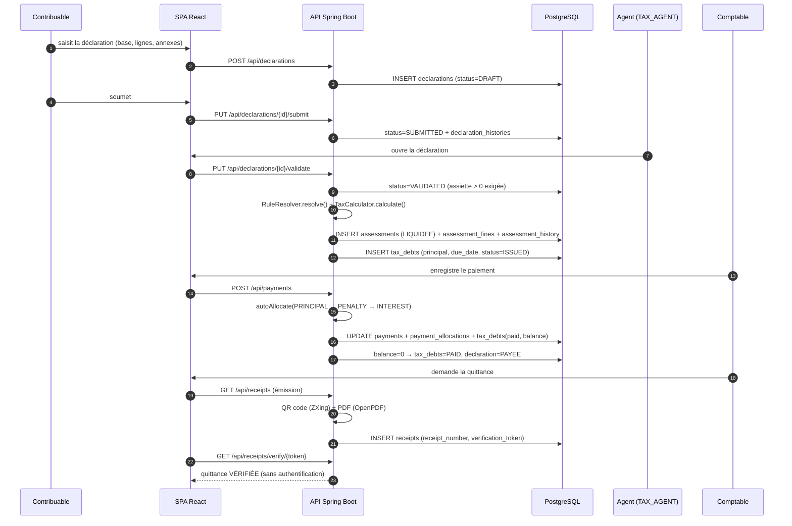
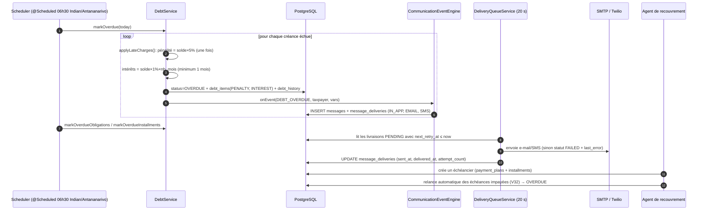
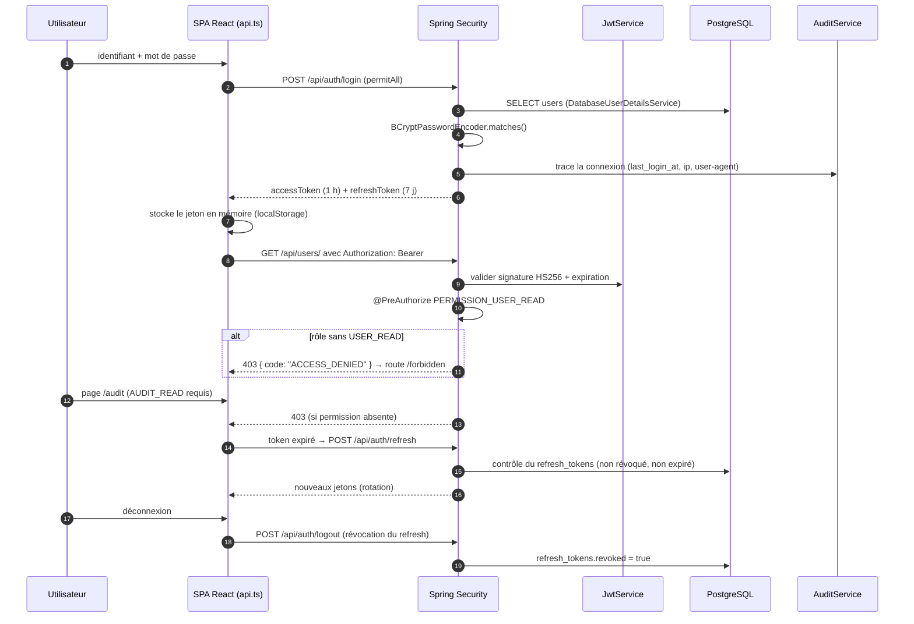
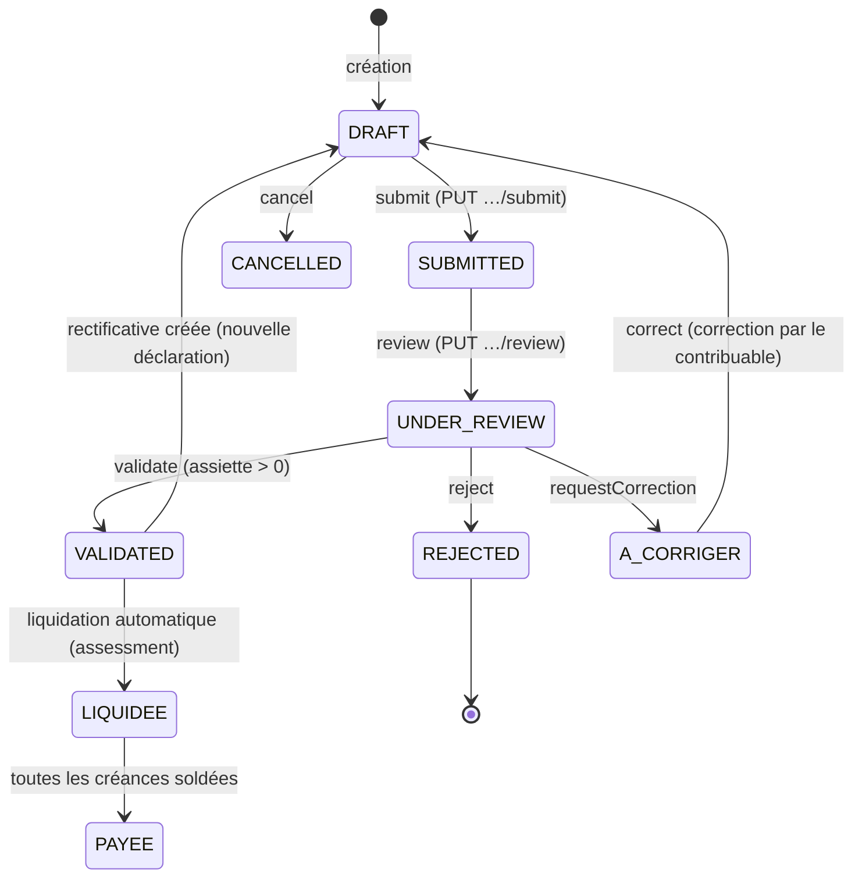

# MNK-TAX — Rapport d'analyse technique (2/3)

> **Partie 2 de 3 — Sections 6 à 11** : acteurs et cas d'utilisation, routes et points d'accès, sécurité, règles de gestion, interfaces, tests.
>
> - Partie 1 : `RAPPORT_PROJET_1.md` (sections 1 à 5)
> - Partie 3 : `RAPPORT_PROJET_3.md` (sections 12 à 15, informations manquantes, annexe pour mémoire)

---

## 6. ACTEURS ET CAS D'UTILISATION

### 6.1 Identification des acteurs

| Acteur | Rôle | Origine | Capacités effectives (permission-maîtres) |
|---|---|---|---|
| **Invité** | Visiteur non connecté | Aucun compte | Consulter l'accueil, s'inscrire, se connecter, **vérifier une quittance** (`/api/receipts/verify/**`) |
| **Contribuable** | Personne physique ou morale assujettie | Rôle `TAXPAYER`, lié à `taxpayers.user_id` | Déposer et corriger ses déclarations, consulter ses obligations, dettes, quittances, déposer des réclamations, gérer son profil, messagerie |
| **Agent des impôts** | Fonctionnaire instructeur | Rôle `TAX_AGENT` | Contribuables, déclarations (validation/rejet), **impositions**, règles fiscales, contrôles fiscaux, référentiels, échéances |
| **Agent de recouvrement** | Service contentieux | Rôle `COLLECTION_AGENT` | Créances, actions de recouvrement, avis/mises en demeure, échéanciers, litiges, enregistrement de paiements |
| **Comptable** | Service des recettes | Rôle `ACCOUNTANT` | Paiements, quittances, remboursements, rapports financiers |
| **Administrateur** | Gestion du système | Rôles `ADMIN` / `SUPER_ADMIN` | Utilisateurs, rôles et permissions, paramètres système, audit, demandes d'inscription, communication, campagnes |
| **Système (planificateur)** | Tâches de fond | `@Scheduled` | Détection des retards, rappels d'échéance, communication automatique, purge d'audit, file d'envoi des livraisons |

> Les 6 rôles sont amorcés par `DemoDataSeeder` ; les rôles `ADMIN` et `SUPER_ADMIN` diffèrent par les permissions `USER_WRITE`, `ROLE_ASSIGN`, `SYSTEM_SETTINGS_*` (migrations `V21`, `V35`).

### 6.2 Diagramme de cas d'utilisation

```mermaid
usecaseDiagram
    actor Invité as G
    actor "Contribuable" as T
    actor "Agent des impôts" as A
    actor "Agent de recouvrement" as R
    actor "Comptable" as C
    actor Administrateur as Adm
    actor Système as S

    package "Accès" {
        usecase UC1 as "S'authentifier (JWT + refresh)"
        usecase UC2 as "Demander un compte"
        usecase UC3 as "Vérifier une quittance (public)"
        usecase UC4 as "Consulter / modifier son profil"
    }
    package "Cycle déclaratif" {
        usecase UC5 as "Déposer une déclaration"
        usecase UC6 as "Instruire et valider la déclaration"
        usecase UC7 as "Liquidation automatique (imposition)"
        usecase UC8 as "Gérer les règles fiscales"
    }
    package "Cycle de recouvrement" {
        usecase UC9 as "Consulter et traiter les créances"
        usecase UC10 as "Appliquer pénalités et intérêts de retard"
        usecase UC11 as "Émettre avis et relances"
        usecase UC12 as "Échelonner un paiement"
        usecase UC13 as "Enregistrer et imputer un paiement"
        usecase UC14 as "Émettre la quittance (QR + PDF)"
    }
    package "Contentieux" {
        usecase UC15 as "Ouvrir un contrôle fiscal"
        usecase UC16 as "Répondre à une réclamation"
        usecase UC17 as "Instruire un remboursement"
    }
    package "Administration" {
        usecase UC18 as "Gérer utilisateurs, rôles, permissions"
        usecase UC19 as "Paramétrer le système"
        usecase UC20 as "Consulter l'audit"
        usecase UC21 as "Piloter la communication et les campagnes"
        usecase UC22 as "Consulter tableaux de bord et rapports"
    }
    package "Automatisation" {
        usecase UC23 as "Détecter les créances en retard"
        usecase UC24 as "Envoyer les rappels d'échéance"
        usecase UC25 as "Traiter la file d'envoi (e-mail/SMS)"
    }

    G --> UC1
    G --> UC2
    G --> UC3
    T --> UC1
    T --> UC4
    T --> UC5
    T --> UC9
    T --> UC16
    A --> UC6
    A --> UC7
    A --> UC8
    A --> UC15
    R --> UC9
    R --> UC10
    R --> UC11
    R --> UC12
    R --> UC13
    C --> UC13
    C --> UC14
    C --> UC17
    C --> UC22
    Adm --> UC18
    Adm --> UC19
    Adm --> UC20
    Adm --> UC21
    Adm --> UC22
    S --> UC23
    S --> UC24
    S --> UC25
    UC7 ..> UC8 : utilise
    UC14 ..> UC3 : vérifiable par
    UC10 ..> UC23 : déclenché par
```

### 6.3 Trois scénarios de bout en bout (avec diagrammes de séquence)

#### Scénario S1 — De la déclaration à la quittance vérifiable

`Dépôt de déclaration → validation agent → liquidation → créance → encaissement → quittance QR/PDF → vérification publique`



**Points de contrôle du scénario** : `assiette ≤ 0 → INVALID_BASE` ; `transaction ≠ somme des imputations → ALLOCATION_MISMATCH` ; création d'une imputation sur créance non payable → `DEBT_NOT_PAYABLE`.

#### Scénario S2 — Créance échue : pénalités, relances, échéancier

`Échéance dépassée → pénalité et intérêts → statut EN_RETARD → relance multicanal → plan d'apurement`



**Points de contrôle** : la pénalité et l'intérêt ne sont appliqués **qu'une fois** (test d'existence d'un `debt_items` de `kind=PENALTY`/`INTEREST`) ; une créance `PAID` ne peut pas recevoir de nouveau mouvement (`DEBT_ALREADY_PAID`) ; `CANCELLED`/`SUSPENDED`/`CLOSED` sont exclus du recalcul automatique de statut.

#### Scénario S3 — Authentification, autorisation et rafraîchissement du jeton

`Connexion → accès contrôlé par permission → refus 403 → refresh → déconnexion`



**Points de contrôle** : `sessionCreationPolicy(STATELESS)` (aucune session serveur) ; réponse d'erreur standardisée `401 ACCESS_DENIED` / `403` via `RestAuthenticationEntryPoint` et `RestAccessDeniedHandler` ; l'historique de sécurité est lu dans `audit_logs`.

---

## 7. ROUTES ET POINTS D'ACCÈS

### 7.1 Côté client — 38 routes (`frontend/src/App.tsx`)

| # | Route | Composant page | Permission exigée |
|---|---|---|---|
| 1 | `/` | `Home` | publique |
| 2 | `/login` | `Login` | publique |
| 3 | `/register` | `Register` | publique |
| 4 | `/verify/receipt/:reference` | `ReceiptVerify` | publique |
| 5 | `/dashboard` | `Dashboard` | `REPORT_READ` |
| 6 | `/taxpayers` | `Taxpayers` | `TAXPAYER_READ` |
| 7 | `/taxpayers/:id` | `TaxpayerDetail` | `TAXPAYER_READ` |
| 8 | `/declarations` | `Declarations` | `DECLARATION_READ` |
| 9 | `/declarations/:id` | `Declarations` | `DECLARATION_READ` |
| 10 | `/assessments` | `Assessments` | `ASSESSMENT_READ` |
| 11 | `/debts` | `Debts` | `DEBT_READ` |
| 12 | `/debts/:id` | `DebtDetail` | `DEBT_READ` |
| 13 | `/collection` | `collection/Overview` | `COLLECTION_READ` |
| 14 | `/collection/overdue` | `collection/Overdue` | `COLLECTION_READ` |
| 15 | `/collection/reminders` | `collection/Reminders` | `COLLECTION_READ` |
| 16 | `/collection/notices` | `collection/Notices` | `COLLECTION_READ` |
| 17 | `/collection/plans` | `CollectionPlans` | `COLLECTION_READ` |
| 18 | `/collection/history` | `CollectionHistory` | `COLLECTION_READ` |
| 19 | `/payments` | `payments/PaymentsList` | `PAYMENT_READ` |
| 20 | `/payments/pending` | `payments/PaymentsPending` | `PAYMENT_READ` |
| 21 | `/payments/stats` | `payments/PaymentsStats` | `PAYMENT_READ` |
| 22 | `/controls` | `Controls` | `CONTROL_READ` |
| 23 | `/complaints` | `Complaints` | `COMPLAINT_READ` |
| 24 | `/refunds` | `Refunds` | `REFUND_READ` |
| 25 | `/receipts` | `Receipts` | `RECEIPT_READ` |
| 26 | `/reports` | `Reports` | `REPORT_READ` |
| 27 | `/deadlines` | `Deadlines` | `TAXONOMY_READ` |
| 28 | `/tax-rules` | `TaxRules` | `RULE_READ` |
| 29 | `/users` | `Users` | `USER_READ` |
| 30 | `/roles` | `Roles` | `ROLE_READ` |
| 31 | `/audit` | `AuditLogs` | `AUDIT_READ` |
| 32 | `/parameters` | `Parameters` | `PARAMETER_READ` |
| 33 | `/registrations` | `RegistrationRequests` | `USER_READ` |
| 34 | `/profile` | `Profile` | aucune (profil personnel) |
| 35 | `/notifications` | `Notifications` | `NOTIFICATION_READ` |
| 36 | `/messages` | `Messages` | `MESSAGE_READ` |
| 37 | `/forbidden` | `Forbidden` | publique |
| 38 | `*` (toute autre) | `NotFound` | publique |

**Fonctionnement de la garde** : `ProtectedRoute` vérifie l'authenticité de la connexion (appel `GET /api/auth/me`) puis, si la prop `permission` est fournie, la présence de l'autorité correspondante ; à défaut il redirige vers `/forbidden`. Après connexion, `frontend/src/lib/navigation.ts` choisit la page d'accueil en fonction des permissions réelles (`/dashboard` si `REPORT_READ`, sinon la première route correspondante, sinon `/profile`).

**Pages** : **37 fichiers `.tsx`** sous `frontend/src/pages/` (dont `collection/` et `payments/`), **45 composants** dans `src/components/`, **54 fichiers** dans `src/features/` (12 modules), **12 modules** dans `src/lib/`.

### 7.2 Côté serveur — 27 contrôleurs, 228 endpoints

**Répartition par contrôleur et par verbe HTTP** (extraction automatique du code) :

| Contrôleur | Base | GET | POST | PUT | PATCH | DELETE | Total |
|---|---|---:|---:|---:|---:|---:|---:|
| `CommunicationController` | `/api/communication` | 9 | 9 | 0 | 1 | 0 | **20** |
| `AuthController` | `/api/auth` | 8 | 10 | 1 | 0 | 1 | **20** |
| `CollectionController` | `/api/collection` | 9 | 7 | 0 | 2 | 0 | **18** |
| `MessageController` | `/api/messages` | 7 | 9 | 0 | 0 | 1 | **17** |
| `DeclarationController` | `/api/declarations` | 5 | 3 | 7 | 0 | 1 | **16** |
| `DebtController` | `/api/debts` | 5 | 2 | 0 | 7 | 1 | **15** |
| `TaxpayerController` | `/api/taxpayers` | 7 | 1 | 1 | 1 | 0 | **10** |
| `AssessmentController` | `/api/assessments` | 5 | 4 | 0 | 1 | 0 | **10** |
| `PaymentController` | `/api/payments` | 4 | 1 | 3 | 0 | 1 | **9** |
| `UserController` | `/api/users` | 3 | 3 | 1 | 1 | 1 | **9** |
| `ReportController` | `/api/reports` | 8 | 0 | 0 | 0 | 0 | **8** |
| `ReceiptController` | `/api/receipts` | 4 | 1 | 2 | 0 | 1 | **8** |
| `RefundController` | `/api/refunds` | 3 | 1 | 0 | 3 | 1 | **8** |
| `TaxRuleController` | `/api/tax-rules` | 4 | 1 | 1 | 1 | 0 | **7** |
| `ComplaintController` | `/api/complaints` | 3 | 2 | 0 | 1 | 1 | **7** |
| `ReferenceController` | `/api/tax-*` | 3 | 3 | 0 | 1 | 0 | **7** |
| `TaxControlController` | `/api/tax-controls` | 2 | 1 | 0 | 2 | 1 | **6** |
| `DeadlineController` | `/api/deadlines` | 2 | 1 | 1 | 0 | 1 | **5** |
| `TaxObligationController` | `/api/obligations` | 1 | 2 | 1 | 0 | 1 | **5** |
| `PaymentPlanController` | `/api/collection/plans` | 3 | 1 | 0 | 1 | 0 | **5** |
| `DocumentController` | `/api/documents` | 2 | 1 | 0 | 0 | 1 | **4** |
| `NotificationController` | `/api/notifications` | 2 | 2 | 0 | 0 | 0 | **4** |
| `RoleController` | `/api/roles` | 1 | 1 | 1 | 0 | 1 | **4** |
| `AuditController` | `/api/audit-logs` | 2 | 0 | 0 | 0 | 0 | **2** |
| `SystemParameterController` | `/api/parameters` | 1 | 0 | 1 | 0 | 0 | **2** |
| `DashboardController` | `/api/dashboard` | 1 | 0 | 0 | 0 | 0 | **1** |
| `AiController` | `/api/ai` | 0 | 1 | 0 | 0 | 0 | **1** |
| **Total** | | **110** | **66** | **22** | **20** | **10** | **228** |

> Tous les contrôleurs sont préfixés `/api/...` ; le contexte applicatif est `server.servlet.context-path=/api` doublé du préfixe `@RequestMapping` de chaque contrôleur (ex. `@RequestMapping("/api/taxpayers")`).

### 7.3 Inventaire complet des endpoints

**Authentification — `AuthController` (20)**
- `POST /api/auth/login`, `POST /api/auth/register`, `POST /api/auth/refresh`, `POST /api/auth/logout`
- `GET /api/auth/me`, `PUT /api/auth/me`, `POST /api/auth/me/avatar`, `GET /api/auth/me/avatar`, `DELETE /api/auth/me/avatar`
- `POST /api/auth/change-password`
- `GET /api/auth/me/sessions`, `POST /api/auth/me/sessions/{id}/revoke`, `POST /api/auth/me/sessions/revoke-all`, `GET /api/auth/me/security-history`
- `GET /api/auth/admin/registrations`, `GET /api/auth/admin/registrations/stats`, `GET /api/auth/admin/registrations/{id}`, `POST /api/auth/admin/registrations/{id}/assign`, `POST /api/auth/admin/registrations/{id}/approve`, `POST /api/auth/admin/registrations/{id}/reject`

**Utilisateurs — `UserController` (9)**
- `GET /api/users/`, `GET /api/users/{id}`, `GET /api/users/{id}/avatar`
- `POST /api/users/`, `PUT /api/users/{id}`, `PATCH /api/users/{id}/enabled`, `DELETE /api/users/{id}`
- `POST /api/users/{id}/reset-password`, `POST /api/users/change-password`

**Rôles — `RoleController` (4)** : `GET /api/roles/`, `POST /api/roles/`, `PUT /api/roles/{id}/permissions`, `DELETE /api/roles/{id}`

**Paramètres système — `SystemParameterController` (2)** : `GET /api/parameters/`, `PUT /api/parameters/`

**Audit — `AuditController` (2)** : `GET /api/audit-logs/`, `GET /api/audit-logs/stats`

**Contribuables — `TaxpayerController` (10)**
- `GET /api/taxpayers/` (recherche), `GET /api/taxpayers/stats`, `GET /api/taxpayers/next-nif`, `GET /api/taxpayers/contacts`
- `GET /api/taxpayers/{id}`, `GET /api/taxpayers/{id}/contact`, `GET /api/taxpayers/nif/{nif}`
- `POST /api/taxpayers/`, `PUT /api/taxpayers/{id}`, `PATCH /api/taxpayers/{id}/status`

**Déclarations — `DeclarationController` (16)**
- `GET /api/declarations/`, `GET /api/declarations/statistics`, `GET /api/declarations/calendar`, `GET /api/declarations/{id}`, `GET /api/declarations/{id}/history`
- `POST /api/declarations/`
- `PUT /api/declarations/{id}`, `PUT /api/declarations/{id}/submit`, `PUT /api/declarations/{id}/review`, `PUT /api/declarations/{id}/validate`, `PUT /api/declarations/{id}/reject`, `PUT /api/declarations/{id}/correction`, `PUT /api/declarations/{id}/correct`, `PUT /api/declarations/{id}/rectificative`, `PUT /api/declarations/{id}/cancel`
- `DELETE /api/declarations/{id}`

**Impositions — `AssessmentController` (10)**
- `GET /api/assessments/`, `GET /api/assessments/{id}`, `GET /api/assessments/{id}/history`, `GET /api/assessments/stats`, `GET /api/assessments/{id}/avis.pdf`
- `POST /api/assessments/simulate`, `POST /api/assessments/office`, `POST /api/assessments/{id}/adjust`, `POST /api/assessments/{id}/notify`, `POST /api/assessments/{id}/cancel`

**Règles fiscales — `TaxRuleController` (7)**
- `GET /api/tax-rules/`, `GET /api/tax-rules/{id}`, `GET /api/tax-rules/versions/recent`, `GET /api/tax-rules/{id}/versions`
- `POST /api/tax-rules/`, `PUT /api/tax-rules/{id}`, `PATCH /api/tax-rules/{id}/active`

**Obligations et calendrier — `TaxObligationController` (5) + `DeadlineController` (5)**
- `GET /api/obligations/`, `POST /api/obligations/`, `PUT /api/obligations/{id}`, `DELETE /api/obligations/{id}`, `POST /api/obligations/generate`
- `GET /api/deadlines/`, `POST /api/deadlines/`, `PUT /api/deadlines/{id}`, `DELETE /api/deadlines/{id}`, `GET /api/deadlines/upcoming`

**Référentiels — `ReferenceController` (7)**
- `GET /api/tax-types`, `POST /api/tax-types`, `PATCH /api/tax-types/{id}/active`
- `GET /api/tax-regimes`, `POST /api/tax-regimes`
- `GET /api/tax-centers`, `POST /api/tax-centers`

**Créances — `DebtController` (15)**
- `GET /api/debts/`, `GET /api/debts/overdue`, `GET /api/debts/{id}`, `GET /api/debts/{id}/history`, `GET /api/debts/stats`
- `POST /api/debts/`, `POST /api/debts/mark-overdue`
- `PATCH /api/debts/{id}/adjustment`, `PATCH /api/debts/{id}/in-collection`, `PATCH /api/debts/{id}/cancel`, `PATCH /api/debts/{id}/suspend`, `PATCH /api/debts/{id}/resume`, `PATCH /api/debts/{id}/close`, `PATCH /api/debts/{id}/priority`, `PATCH /api/debts/{id}/observations`

**Recouvrement — `CollectionController` (18)**
- `GET /api/collection/debts`, `GET /api/collection/periods`, `GET /api/collection/overdue-summary`, `GET /api/collection/detail/{id}`, `GET /api/collection/stats`
- `GET /api/collection/actions`, `POST /api/collection/actions`
- `GET /api/collection/notices`, `POST /api/collection/notices`
- `GET /api/collection/history/{debtId}`, `GET /api/collection/events`
- `GET /api/collection/documents/mise-en-demeure/{debtId}`, `GET /api/collection/documents/relance/{debtId}`, `GET /api/collection/documents/etat-restes`
- `GET /api/collection/disputes/{id}`, `POST /api/collection/disputes`, `PATCH /api/collection/disputes/{id}/decision`
- `POST /api/collection/payment`

**Échéanciers — `PaymentPlanController` (5)** : `GET /api/collection/plans/`, `GET /api/collection/plans/stats`, `GET /api/collection/plans/{id}`, `POST /api/collection/plans/`, `PATCH /api/collection/plans/{id}/cancel`

**Paiements — `PaymentController` (9)**
- `GET /api/payments/`, `GET /api/payments/{id}`, `GET /api/payments/stats`, `GET /api/payments/{id}/reconcile`
- `POST /api/payments/`
- `PUT /api/payments/{id}/confirm`, `PUT /api/payments/{id}/allocate`, `PUT /api/payments/{id}/cancel`, `PUT /api/payments/{id}/reject`

**Quittances — `ReceiptController` (8)**
- `GET /api/receipts/`, `GET /api/receipts/stats`, `GET /api/receipts/{id}`, `GET /api/receipts/{id}/pdf`
- `PUT /api/receipts/{id}/cancel`, `PUT /api/receipts/{id}/refund`
- `POST /api/receipts/{id}/replace`
- `GET /api/receipts/verify/{token}` ← **seul point d'accès public métier avec `/api/auth/login|refresh|register`**

**Contrôle fiscal — `TaxControlController` (6)** : `GET /api/tax-controls/`, `GET /api/tax-controls/{id}`, `POST /api/tax-controls/`, `PATCH /api/tax-controls/{id}`, `PATCH /api/tax-controls/{id}/close`, `DELETE /api/tax-controls/{id}`

**Réclamations — `ComplaintController` (7)** : `GET /api/complaints/`, `GET /api/complaints/{id}`, `GET /api/complaints/stats`, `POST /api/complaints/`, `PATCH /api/complaints/{id}`, `POST /api/complaints/{id}/responses`, `DELETE /api/complaints/{id}`

**Remboursements — `RefundController` (8)** : `GET /api/refunds/`, `GET /api/refunds/{id}`, `GET /api/refunds/stats`, `POST /api/refunds/`, `PATCH /api/refunds/{id}`, `PATCH /api/refunds/{id}/review`, `PATCH /api/refunds/{id}/pay`, `DELETE /api/refunds/{id}`

**Messagerie — `MessageController` (17)**
- `GET /api/messages`, `GET /api/messages/sent`, `GET /api/messages/archived`, `GET /api/messages/stats`, `GET /api/messages/{id}`, `GET /api/messages/{id}/thread`, `GET /api/messages/attachments/{attachmentId}`, `GET /api/messages/unread-count`
- `POST /api/messages`, `POST /api/messages/{id}/read`, `POST /api/messages/{id}/thread-read`, `POST /api/messages/read-all`, `POST /api/messages/{id}/archive`, `POST /api/messages/{id}/unarchive`, `POST /api/messages/{id}/close`, `POST /api/messages/{id}/reopen`, `POST /api/messages/{id}/attachments`

**Communication — `CommunicationController` (20)**
- Envoi et suivi : `POST /api/communication/preview`, `POST /api/communication/send`, `POST /api/communication/test`, `GET /api/communication/senders`, `GET /api/communication/sent`, `GET /api/communication/stats`, `GET /api/communication/providers`
- Livraisons : `GET /api/communication/messages/{id}/deliveries`, `POST /api/communication/messages/{id}/retry`, `POST /api/communication/messages/{id}/cancel`
- Modèles : `GET /api/communication/templates`, `POST /api/communication/templates`, `POST /api/communication/templates/render`
- Campagnes : `GET /api/communication/campaigns`, `POST /api/communication/campaigns`, `GET /api/communication/campaigns/preview`
- Règles d'événements : `GET /api/communication/event-rules`, `POST /api/communication/event-rules/{id}`
- Boîte : `GET /api/communication/my-messages`, `POST /api/communication/my-messages/{id}/read`

**Notifications — `NotificationController` (4)** : `GET /api/notifications/`, `GET /api/notifications/unread-count`, `POST /api/notifications/read-all`, `POST /api/notifications/{id}/read`

**Documents — `DocumentController` (4)** : `GET /api/documents/`, `POST /api/documents/`, `GET /api/documents/{id}/content`, `DELETE /api/documents/{id}`

**Reporting — `DashboardController` (1) + `ReportController` (8)**
- `GET /api/dashboard/summary`
- `GET /api/reports/stats`, `/stats/declarations`, `/stats/debts`, `/collection`, `/payments`, `/declarations`, `/taxpayers`, `/activity`

**Assistant — `AiController` (1)** : `POST /api/ai/chat`

### 7.4 Remarques sur l'API

| Point | Constat |
|---|---|
| Cohérence | 100 % des endpoints sont sous `/api/`, format JSON, pagination `page/size/…` sur les listes |
| Path variables | Certains contrôlent le type : `{id:\d+}` (Déclarations, Contribuables) |
| **Double préfixe** | `PaymentPlanController` expose `/api/collection/plans` et `CollectionController` `/api/collection` : les routes d'échéancier sont rattachées au paquet `paymentplan` mais au chemin « collection » |
| Verbes | Respect global du CRUD REST ; `PATCH` pour les transitions partielles (statuts), `PUT` pour les actions métier (validation, soumission) |
| Documentation | Chaque endpoint porte `@Operation` (springdoc) ; Swagger UI accessible si `EXPOSE_API_DOCS` |
| **Répétition** | `UserController.changePassword` et `AuthController.changePassword` exposent deux chemins pour une même opération |

---

## 8. SÉCURITÉ

### 8.1 Authentification

| Élément | Implémentation vérifiée |
|---|---|
| Mécanisme | **JWT HMAC-SHA** signé (`auth/security/JwtService.java`, JJWT 0.12.6) |
| Jeton d'accès | `jwt.access-token-ttl: 3600` s (**1 heure**), configurable `JWT_ACCESS_TTL` |
| Jeton de rafraîchissement | `jwt.refresh-token-ttl: 604800` s (**7 jours**), stocké en base (`refresh_tokens`, table lisible/ révocable), configurable `JWT_REFRESH_TTL` |
| Mot de passe | **BCrypt** (`SecurityConfig.passwordEncoder()`), comparaison par `passwordEncoder.matches(...)` |
| Filtrage | `JwtAuthFilter` : lit `Authorization: Bearer`, charge l'utilisateur (`DatabaseUserDetailsService`) et remplit le `SecurityContextHolder` |
| Sessions | `SessionCreationPolicy.STATELESS` — aucune session HTTP ; les « sessions » affichées côté IHM sont les lignes `refresh_tokens` (révocation, IP, user-agent) |
| Portée | `docs/SECURITY.md` documente un JWT unique + refresh révocable |

### 8.2 Autorisation (RBAC)

- `@EnableMethodSecurity` + **211 occurrences `@PreAuthorize`** dans les contrôleurs.
- Autorités exposées sous la forme **`PERMISSION_<CODE>`** par `CustomUserDetails` (les bases stockent le code nu `TAXPAYER_READ`).
- **90 constantes** déclarées dans `auth/security/Permissions.java` ; **66 codes** amorcés par `DemoDataSeeder`, complétés par les migrations `V19`, `V21` (~34 codes) et `V35` — les 90 constantes sont toutes couvertes en base.
- **6 rôles** (`SUPER_ADMIN`, `ADMIN`, `TAX_AGENT`, `COLLECTION_AGENT`, `ACCOUNTANT`, `TAXPAYER`) liés par `user_roles` / `role_permissions`.

**Permissions les plus représentatives** : `TAXPAYER_READ|WRITE|DELETE|EXPORT`, `DECLARATION_READ|WRITE|VALIDATE|REJECT|CORRECT`, `ASSESSMENT_READ|WRITE`, `DEBT_READ|WRITE|CREATE`, `COLLECTION_READ|WRITE`, `PAYMENT_READ|WRITE`, `RECEIPT_READ|WRITE`, `REPORT_READ`, `RULE_READ|WRITE`, `CONTROL_READ|WRITE`, `COMPLAINT_READ|WRITE`, `REFUND_READ|WRITE`, `MESSAGE_READ`, `NOTIFICATION_READ`, `USER_READ|WRITE`, `ROLE_READ|WRITE`, `AUDIT_READ`, `PARAMETER_READ`, `TAXONOMY_READ`, `OBLIGATION_READ|WRITE`.

**Contrôle côté client** : `ProtectedRoute` teste la permission avant montage de la page (défense en second rang, pas une sécurité).

### 8.3 Points d'accès publics (hors authentification)

`SecurityConfig.securityFilterChain` autorise explicitement :
- `/api/auth/login`, `/api/auth/refresh`, `/api/auth/register` ;
- **`/api/receipts/verify/**`** (vérification publique des quittances) ;
- `/actuator/health`, `/actuator/info` ;
- `/v3/api-docs/**`, `/swagger-ui/**`, `/swagger-ui.html`, `/h2-console/**`.

> **À noter** : la documentation Swagger (`/swagger-ui/**`, `/v3/api-docs/**`) et la console H2 (`/h2-console/**`) sont dans la liste `permitAll` : elles sont **accessibles sans authentification** lorsqu'elles sont activées. Le profil `prod` les désactive (`expose-api-docs: ${EXPOSE_API_DOCS:false}`), mais la valeur par défaut de `application.yml` est `EXPOSE_API_DOCS:true` et le profil `dev` les laisse ouvertes (voir annexe A.9).

### 8.4 Paramètres de protection

| Paramètre | Valeur (fichier de configuration) | Effet |
|---|---|---|
| **CSRF** | `csrf(...disable())` | Désactivé — cohérent avec un API stateless à jeton (le jeton n'étant pas un cookie, pas d'attaque CSRF classique) |
| **CORS** | `common/config/CorsConfig.java` : origines listées dans `cors.allowed-origins`, méthodes `GET,POST,PUT,PATCH,DELETE,OPTIONS`, en-têtes `*`, `allowCredentials(true)`, en-tête exposé `X-Correlation-Id` | Limitation à l'origine front configurée (Render) |
| **Rate limiting** | `rate-limit.enabled`, `requests-per-minute: 120` (`RATE_LIMIT_ENABLED`, `RATE_LIMIT_PER_MINUTE`) via `RateLimitInterceptor` | Limitation mémoire par fenêtre glissante (non persistée : à réinitialiser à chaque redémarrage, non partagée entre instances) |
| **Secret JWT** | `jwt.secret: ${JWT_SECRET:<base64 de repli>}` (`application.yml:57`) | **Une valeur par défaut base64 est codée en dur** (chaîne placeholder du type `change-me…`, non reproduite ici) : sans `JWT_SECRET`, tous les jetons seraient signés avec cette valeur connue (annexe A.9, P1.2) |
| **Téléversements** | `spring.servlet.multipart.max-file-size/max-request-size: 10MB` | Limite générique (avatars, annexes, pièces) |
| **Fichiers** | `document.storage-path`, `avatar.storage-path`, `receipt.storage-path` (profil `render` : `data/…`) | Stockage **hors base**, servi par contrôleur (pas de stockage public) |
| **HTTPS** | Aucune configuration `server.ssl` / HSTS trouvée | Le TLS est porté par Render/Neon (à documenter dans le mémoire) |
| **Actuator** | Seuls `health` et `info` ouverts | Pas d'exposition d'indicateurs sensibles |

### 8.5 Traçabilité et contrôle d'accès aux données

- **Audit** : `AuditService` écrit `action`, `entity_type`, `entity_id`, avant/après (`old_value`/`new_value`), IP et user-agent ; journal consultable via `GET /api/audit-logs` (`AUDIT_READ`) ; purge quotidienne `AuditRetentionService` (cron `0 30 2 * * *`).
- **Périmètre de données** : `common/util/SecurityUtils.currentUsername()` est transmis à chaque écriture (`created_by`, `submitted_by`, `performed_by`) ; un composant `taxpayer/service/DataScope.java` restreint la consultation des contribuables selon le profil (nouveauté du dépôt).
- **Secrets** : aucun secret de production dans le dépôt ; `.env.example` ne contient que les **noms** de variables (31). Les identifiants de démonstration sont publics (`admin`, `agent.tax`, `agent.collection`, `accountant`, `taxpayer.demo`, `superadmin`) — leurs mots de passe ne sont **pas** reproduits dans ce rapport.

### 8.6 Synthèse des vulnérabilités résiduelles

Le détail des constats (gravité, emplacement, correction proposée) figure à l'**annexe A.9** (partie 3) :

- **P1 (à corriger avant toute mise en ligne)** : `SEED_DEMO=true` force le jeu de démonstration (`render.yaml`), mots de passe temporaires renvoyés dans la réponse HTTP d'approbation, valeur par défaut du secret JWT dans `application.yml`.
- **P2 (documentation/exploitation)** : Swagger et console H2 déclarés `permitAll` (ouverts tant que `EXPOSE_API_DOCS` n'est pas désactivé), `/api/ai/chat` sans `@PreAuthorize` (accessible à tout compte authentifié), rate-limit en mémoire (non partagé), CSRF désactivé.
- **P3 (qualité/robustesse)** : colonnes orphelines (`mfa_enabled`), `audit_logs` sans clé étrangère, HTTPS/HSTS non configurés côté applicatif, console H2 active en `dev`.

---

## 9. RÈGLES DE GESTION

### 9.1 Identité et référentiel

| Règle | Implémentation | Source |
|---|---|---|
| NIF = **10 chiffres** | `common/util/NifValidator.java` : regex `^[0-9]{10}$` uniquement | `NifValidatorTest` (16 exécutions) |
| *Contrôle de clé mod 97* | **NON IMPLÉMENTÉ** — aucune occurrence dans le code | Écart avec `docs/DATABASE.md` qui le mentionne |
| Téléphone internationalisé | `common/util/PhoneUtil` : normalisation → `taxpayers.phone_normalized` | `PhoneUtilTest` |
| Unicité du NIF | `CONSTRAINT uk_taxpayer_nif UNIQUE (nif)` | `V1` |
| NIF suivant proposé | `GET /api/taxpayers/next-nif` | `TaxpayerController` |
| Régime d'imposition | `tax_regimes` (code, catégorie, TVA applicable, périodicité) | `V1`, `V16` |

### 9.2 Cycle de vie de la déclaration

**Statuts possibles** (`DeclarationStatus`) : `DRAFT`, `SUBMITTED`, `UNDER_REVIEW`, `VALIDATED`, `REJECTED`, `A_CORRIGER`, `CANCELLED`, `LIQUIDEE`, `PAYEE`.



- **Garde** : `INVALID_BASE` si l'assiette est ≤ 0 à la validation (`DeclarationService.java:277`), `INVALID_TRANSITION` si la transition est interdite (`:504`, `:511`), `TAXPAYER_CLOSED` si le contribuable est fermé (`:487`).
- **Traçabilité** : chaque transition insère une ligne `declaration_histories` (ancien/nouveau statut, auteur, commentaire, données avant/après).
- **Paiement global** : la déclaration passe à `PAYEE` uniquement quand **toutes** ses créances sont soldées (`DebtService.markDeclarationPaidIfFullyPaid`, `countNonPaidByDeclarationId == 0`).

### 9.3 Calcul de l'impôt — `tax/engine/TaxCalculator.java`

| Méthode de calcul | Formule appliquée (code) |
|---|---|
| `FLAT_RATE` / `PERCENTAGE_OF_BASE` / `PERCENTAGE_OF_TURNOVER` | `impôt = assiette × taux / 100` (arrondi `HALF_UP`, 2 décimales) |
| `PROGRESSIVE` | Lecture du JSON `brackets` : `[{"upTo":…,"rate":…}, …]` ; somme sur chaque tranche de `part_de_l_assiette × taux / 100` ; si `brackets` absent ou vide → repli sur le taux unique |
| `PER_UNIT` | `impôt = taux × assiette` (montant forfaitaire par unité) |
| Plancher / plafond | `minimum` imposé si résultat < `minimum` ; `maximum` imposé si résultat > `maximum` |
| **Net** | `net = impôt_brut − exonération − déduction` (`CalculationResult` : `gross`, `deduction`, `net`) |
| Erreurs | `INVALID_BRACKETS` (JSON de tranches invalide), `INVALID_BASE` (assiette négative) |

**Sélection de la règle** — `tax/engine/RuleResolver.resolve()` : filtre par type d'impôt, type de contribuable, régime, activité, dates de validité (`effective_from`/`effective_to`) et statut `is_active` ; **la règle la plus spécifique l'emporte**, sinon repli sur la règle générique (`RuleResolverTest.uncoveredRegimeFallsBackToGeneric` — test actuellement **en échec**, voir §11).

### 9.4 Cycle de vie de l'imposition

- **Statuts** (`AssessmentStatus`) : `EMISED` → `NOTIFIEE` → `ANNULEE`.
- **Origines** (`V34`) : `DECLARATIVE` (depuis déclaration validée), `RECTIFICATIVE` (delta), `REDRESSEMENT` (contrôle fiscal), `OFFICE` (saisie manuelle `POST /api/assessments/office`).
- Une imposition peut être **annulée** (`POST /{id}/cancel`), **ajustée** (`/adjust`) et **notifiée** (`/notify`) ; l'imposition fille est liée par `assessments.parent_id`.
- À l'émission, l'imposition reprend `rule_code` et `rule_version` : le calcul est donc **reproductible** même si la règle change ensuite (versionnage `tax_rule_versions`).
- Un **avis PDF** est généré : `GET /api/assessments/{id}/avis.pdf`.

### 9.5 Créances : composition, retard, transitions

**Composition d'une créance** (`tax_debts` + `debt_items`) :

```
total_amount = principal + penalty + interest − adjustments − credits   (jamais < 0)
balance      = total_amount − paid_amount                              (jamais < 0)
```

**Majorations de retard** (`DebtService.applyLateCharges`, déclenché par le cron quotidien `markOverdue`) :

| Charge | Formule (code) | Défaut |
|---|---|---|
| **Pénalité de retard** | `solde × taux / 100` (une seule fois, si aucun `debt_items` de `kind=PENALTY`) | taux `PEN_DEMO_5` = **5 %** (`system_parameters.PENALTY_RATE` = 5) |
| **Intérêts de retard** | `solde × taux × max(1, mois entre due_date et aujourd'hui) / 100` (une seule fois, `kind=INTEREST`) | taux `INT_DEMO_1` = **1 %/mois** (`INTEREST_RATE_MONTHLY` = 1) |

**Statuts** (`DebtStatus`) : `DRAFT`, `ISSUED`, `DUE`, `PARTIALLY_PAID`, `PAID`, `OVERDUE`, `IN_COLLECTION`, `DISPUTED`, `SUSPENDED`, `CLOSED`, `CANCELLED`.

**Recalcul automatique du statut** (`DebtService.recalculate`) :
1. `balance == 0` → `PAID` + `closed_at` + déclaration soldée éventuellement `PAYEE` ;
2. sinon si `paid_amount > 0` → `PARTIALLY_PAID` (sauf si déjà `IN_COLLECTION`) ;
3. sinon si `due_date < aujourd'hui` → `OVERDUE` ;
4. `CANCELLED` / `SUSPENDED` / `CLOSED` : statut **figé**.

**Transitions interdites (exceptions métier)** : `DEBT_ALREADY_PAID`, `DEBT_CLOSED`, `DEBT_HAS_PAYMENTS` (annulation d'une créance payée), `DEBT_TRANSITION_INVALID`, `DEBT_NOT_SUSPENDED`, `DEBT_NOT_DISPUTED`, `TAXPAYER_REQUIRED`.

### 9.6 Paiements et imputation

- **Statuts du paiement** (`PaymentStatus`) : `PENDING` → `CONFIRMED` → `ALLOCATED` / `PARTIALLY_ALLOCATED` ; aussi `REJECTED`, `CANCELLED`, `REFUNDED`.
- **Imputation** (`PaymentAllocationService`) : ventilation par **composantes** dans l'ordre `PRINCIPAL` → `PENALTY` → `INTEREST` ; contrôle `ALLOCATION_MISMATCH` si la somme des imputations ≠ montant du paiement ; `DEBT_NOT_PAYABLE` si la créance est `PAID`/`CLOSED`/`CANCELLED` ; `ALREADY_ALLOCATED` si tout est déjà imputé.
- **Rapprochement** : `GET /api/payments/{id}/reconcile` vérifie `somme(imputations) + unpaid_amount == amount` (incohérence signalée).
- **Annulation** : remet `allocated_amount = 0`, rétablit les créances (`paymentReversal = true` autorise une créance `PAID` à redevenir `PARTIALLY_PAID`/`OVERDUE`/`ISSUED`).

### 9.7 Quittances

- **Une quittance** porte un `receipt_number` unique et un **`verification_token` unique obligatoire** (`V19`) ; depuis `V22`, **plusieurs quittances peuvent émaner d'un même paiement** (paiements partiels par créance).
- **Émission** : génération du **QR code** (ZXing, chemin `qr_code_path`) et du **PDF** (OpenPDF, `pdf_path`), horodatage `issued_at`.
- **Cycle de vie** (`ReceiptStatus`) : `GENERATED`, `ISSUED`, `VALID`, `CANCELLED`, `REFUNDED`, `REPLACED`, `VOID`.
- **Opérations** : annulation (`/cancel`, motif obligatoire), remplacement (`/replace` renseigne `replaced_by_reference`), remboursement (`/refund`).
- **Vérification publique** : `GET /api/receipts/verify/{token}` — accessible **sans authentification** (`permitAll`).

### 9.8 Recouvrement

| Objet | Règles |
|---|---|
| Actions de recouvrement | `collection_actions` : type, date, résultat, agent responsable, statut `PLANNED` ; `next_action`/`next_action_date` (V8) |
| Avis / mises en demeure | `collection_notices` : numéro unique, type, contenu, `DRAFT` → envoyé (`sent_at`) |
| Documents | Trois PDF serveur : mise en demeure, relance, état des restes (`GET /api/collection/documents/…`) |
| Litiges | `debt_disputes` : `OPEN` → `RESOLVED` avec décision `SUSTAINED`/`REJECTED`/`WITHDRAWN` ; une créance en litige passe `DISPUTED` |
| Échéanciers | `payment_plans` (`ACTIVE`/`COMPLETED`/`CANCELLED`) + échéances (`PENDING`/`PARTIALLY_PAID`/`PAID`/`OVERDUE`/`CANCELLED`) ; `markOverdueInstallments` marque les échéances impayées |
| Relances automatiques | Événements `DEBT_OVERDUE`, `INSTALLMENT_OVERDUE` (V31/V32) → messages selon `communication_event_rules` |

### 9.9 Contrôle fiscal, réclamations, remboursements

- **Contrôle** : `OPEN` → `IN_PROGRESS` → `ANOMALY_DETECTED` → `REDRESSEMENT` → `CLOSED` ; le redressement saisie `redressement`, `penalty_amount` et rattache une **créance** (`tax_controls.debt_id`) ; pièces demandées/reçues (`control_documents`).
- **Réclamation** : `OPEN` → `UNDER_REVIEW` → `ACCEPTED`/`REJECTED` → `CLOSED`, avec fil de réponses (`complaint_responses`) et lien de contexte (déclaration, créance, paiement, contrôle).
- **Remboursement** : `PENDING` → `UNDER_REVIEW` → `APPROVED`/`REJECTED` → `PAID` (montant approuvé partiel possible, motif de rejet obligatoire si rejeté).

### 9.10 Communication et notifications

- **Déclencheurs configurables en base** (`communication_event_rules`) : `event_type` + `template_code` + `channels` + `day_offset` + `enabled` — **aucun déclencheur n'est codé en dur** (paliers J-7/J-3/J-1/J-0 ajoutés par `V36`).
- **Rendu** : variables `{{taxpayer_name}}`, `{{debt_reference}}`, `{{amount}}`, `{{due_date}}`… ; corps distincts FR/MG/EN et corps **SMS** (`sms_content`, V36).
- **Livraison** : `message_deliveries` (`PENDING` → `SENT` → `DELIVERED`/`FAILED`), `max_attempts = 3`, reprise automatique par `DeliveryQueueService` (poll toutes les 20 s), journalisé `last_error`.
- **Fournisseurs** : `EMAIL` = SMTP (`SmtpEmailProvider`), `SMS` = Twilio (`TwilioSmsProvider`) ; configuration inactive par défaut (voir annexe A.8).
- **Notifications** : `notifications` par utilisateur, `is_read`/`read_at`, badge d'inutilisés (`unread-count`).

### 9.11 Paramètres et référentiels de calcul

| Clé (`system_parameters`) | Rôle | Valeur amorcée |
|---|---|---|
| `VAT_RATE` | Taux de TVA de référence | `20` |
| `PENALTY_RATE` | Taux de pénalité de retard (%) | `5` |
| `INTEREST_RATE_MONTHLY` | Taux d'intérêt mensuel (%) | `1` |
| `DEBT.DEFAULT_PENALTY_CODE` | Code de pénalité appliqué par défaut | `PEN_DEMO_5` |
| `DEBT.DEFAULT_INTEREST_CODE` | Code d'intérêt appliqué par défaut | `INT_DEMO_1` |

> Toutes ces valeurs sont **amorcées par `DemoDataSeeder` avec `is_demo = true`** : ce sont des **valeurs de démonstration**, pas des taux légaux (voir §15 et annexe A.2 — **aucune référence légale exploitable n'a été trouvée** dans le code).

### 9.12 Exceptions métier

`common/exception/GlobalExceptionHandler.java` convertit `BusinessException` en réponse JSON `400` (champ `code`) et en `403` pour `ACCESS_DENIED`. Codes relevés dans le code : `INVALID_ARGUMENT`, `INVALID_BASE`, `INVALID_BRACKETS`, `INVALID_TRANSITION`, `TAXPAYER_REQUIRED`, `TAXPAYER_CLOSED`, `DEBT_ALREADY_PAID`, `DEBT_CLOSED`, `DEBT_HAS_PAYMENTS`, `DEBT_TRANSITION_INVALID`, `DEBT_NOT_SUSPENDED`, `DEBT_NOT_DISPUTED`, `ALLOCATION_MISMATCH`, `ALREADY_ALLOCATED`, `DEBT_NOT_PAYABLE`, `INVALID_STATUS`, `ALREADY_CANCELLED`, `ALREADY_REFUNDED`.

### 9.13 Tâches planifiées (`@Scheduled`, 5 tâches)

| Tâche | Cron par défaut | Rôle |
|---|---|---|
| `FiscalSchedulerService` | `0 30 6 * * *` (`Indian/Antananarivo`) | Détecte les créances en retard (+ majorations), obligations échues, échéances impayées |
| `CommunicationSchedulerService` | `0 15 7 * * *` | Déclenche les communications automatiques (règles d'événements) |
| `NotificationService` (échéances) | `0 0 7 * * *` | Rappels d'échéance de déclaration/paiement |
| `DeliveryQueueService` | `fixedDelay` 20 s | Vide la file d'envoi e-mail/SMS avec nouvelles tentatives |
| `AuditRetentionService` | `0 30 2 * * *` | Purge des `audit_logs` selon la rétention paramétrée |

---

## 10. INTERFACES

### 10.1 Structure générale de l'IHM

**Pile** : React 19 + React Router 7 + TanStack Query + Tailwind CSS v4 (config « CSS-first » dans `src/index.css`), composants 100 % maison (aucune librairie UI tierce), icônes `lucide-react`, graphiques `recharts`.

**Coque applicative** (`Layout.tsx`) = `Header` + `Sidebar` + zone de contenu ; les routes sont protégées par `ProtectedRoute` et rendues dans `<Outlet>`.

**Latéral de navigation** (`Sidebar.tsx`, `navSections`) : chaque entrée porte sa `permission`, et `filterNavSections(permissions)` **masque les rubriques non autorisées**.

| Section du menu | Entrées | Permission |
|---|---|---|
| *Tableau de bord* | `/dashboard` | `REPORT_READ` |
| **Gestion** | `/taxpayers`, `/declarations`, `/assessments`, `/debts`, `/collection` (6 sous-routes), `/payments` (4 sous-routes), `/controls`, `/complaints`, `/refunds`, `/messages` | respectivement `TAXPAYER_READ`, `DECLARATION_READ`, `ASSESSMENT_READ`, `DEBT_READ`, `COLLECTION_READ`, `PAYMENT_READ`/`RECEIPT_READ`, `CONTROL_READ`, `COMPLAINT_READ`, `REFUND_READ`, `MESSAGE_READ` |
| **Référentiels** | `/deadlines`, `/tax-rules`, `/reports` | `TAXONOMY_READ`, `RULE_READ`, `REPORT_READ` |
| **Administration** | `/users`, `/registrations`, `/roles`, `/audit`, `/parameters` | `USER_READ`, `USER_READ`, `ROLE_READ`, `AUDIT_READ`, `PARAMETER_READ` |

S'y ajoutent des liens personnels : `/profile`, `/notifications`, et le bouton **« Vérifier une quittance »** (accès public).

### 10.2 Pages et écrans

| Module | Pages | Contenu principal |
|---|---|---|
| Accueil | `Home` | Page de présentation (« landing ») : hero animé, sections argumentaires, 12 composants dédiés (`components/landing/`), animations `FiscalAnimation`, `FiscalAnimation3D`, `FallingMoney` |
| Connexion | `Login`, `Register`, `Forbidden`, `NotFound` | Formulaire de connexion (moyens de secours affichés), inscription, pages d'erreur |
| Tableau de bord | `Dashboard` | Indicateurs agrégés (`/api/dashboard/summary`), graphiques `recharts` |
| Contribuables | `Taxpayers`, `TaxpayerDetail` | Liste filtrable/sortable + fiche à 10 onglets (identité, obligations, déclarations, dettes, paiements, quittances, contrôles, réclamations, documents, historique) |
| Déclarations | `Declarations` | Liste, création assistée, onglets par statut, actions de workflow |
| Impositions | `Assessments` | Liste, calcul, avis PDF, historique |
| Créances | `Debts`, `DebtDetail` | Liste, détail avec composantes, actions d'état (suspendre, clôturer, recouvrement) |
| Recouvrement | `collection/Overview`, `Overdue`, `Reminders`, `Notices`, `CollectionPlans`, `CollectionHistory` | Vue d'ensemble, retards, relances, avis, échéanciers, historique |
| Paiements | `payments/PaymentsList`, `PaymentsPending`, `PaymentsStats` | Enregistrement, validation en attente, statistiques |
| Quittances | `Receipts`, `ReceiptVerify` | Liste, édition PDF, et **page publique de vérification** |
| Contentieux | `Controls`, `Complaints`, `Refunds` | Contrôles fiscaux, réclamations, remboursements |
| Messagerie | `Messages`, `Notifications` | Centre de messages (fils, pièces jointes, contexte) et notifications |
| Reporting | `Reports`, `Deadlines`, `TaxRules` | Statistiques, calendrier fiscal, édition des règles |
| Administration | `Users`, `Roles`, `Parameters`, `AuditLogs`, `RegistrationRequests`, `Profile` | Comptes, rôles/permissions, paramètres, audit, demandes d'inscription, profil (mot de passe, sessions, avatar, langue) |

### 10.3 Composants transverses

| Composant | Rôle |
|---|---|
| `ui.tsx` | Design system local (boutons, champs, cartes, badges, tableaux) |
| `Header.tsx` | Recherche globale (`GlobalSearch`), sélecteur de langue et de thème, notifications, assistant |
| `Sidebar.tsx` | Navigation filtrée par permissions, groupes dépliables, carte de contexte |
| `ProtectedRoute.tsx` | Garde d'authentification + de permission (redirection `/forbidden`) |
| `Stepper.tsx` | Assistants multistades (création de créance, campagne, contrôle) |
| `Toast.tsx` | Notifications éphémères |
| `Avatar` / `UserAvatar` | Images de profil (avec repli initiales) |
| `AiAssistant.tsx` | Bulle d'assistant conversationnel (animations `motion`, Markdown `react-markdown`) |
| `PortalDropdown` / `RowActionPortal` | Menus d'action en portail (tableaux denses) |
| `WelcomeHero`, `FiscalAnimation(3D)`, `FallingMoney` | Ambiance de la page d'accueil |

**Couche données** : `lib/api.ts` (instance axios : jeton, refresh silencieux, `Accept-Language`) + `features/<module>/api/{keys,queries,mutations}.ts` → hooks TanStack Query (**289 `useQuery`, 172 `useMutation`** relevés dans `frontend/src`).

### 10.4 Multilingue, thème, accessibilité

| Fonctionnalité | Implémentation |
|---|---|
| **Langues** | `fr` (français), `mg` (malgache), `en` (anglais) — 3 fichiers `src/locales/*.ts` d'environ **1 600 clés** chacun, test de parité `i18n-parity.test.ts` |
| Sélection | Sélecteur dans l'en-tête ; préférence persistée ; l'API reçoit `Accept-Language` (`fr-MG`, `mg-MG`, `en-US`) |
| **Thème** | Clair/sombre (`lib/theme.tsx`, classes Tailwind `dark:`), bascule en en-tête, préférence persistée |
| **Accessibilité** | Styles `:focus-visible`, libellés `aria-*`, régions `aria-live` sur les filtres, hiérarchie de titres, contrastes `slate`/`brand` |
| **Responsive** | Menu hamburger < 768 px, tableaux en défilement horizontal, cartes empilées en mobile, dialogues adaptés |
| **États** | Skeletons de chargement, `ErrorState`, messages d'erreur serveur, confirmations avant action destructive |
| **Exports** | `lib/exporters.ts` (`exportTable`) et `lib/csv.ts` : export tabulaire **côté navigateur** (CSV) — aucun export serveur |
| **Formats** | `lib/format.ts` : montants en **Ar (MGA)** avec séparateur, dates localisées |

---

## 11. TESTS ET QUALITÉ

### 11.1 Tests backend (JUnit 5 + Spring Boot Test + H2)

**17 classes de test** dans `backend/src/test/java/` :

| Classe | Type | Exécutions (dernier run) | Couvre |
|---|---|---:|---|
| `AiServiceTest` | unitaire | 18 | Réponses de l'assistant |
| `AiTextMatcherTest` | unitaire | 13 | Appariement texte / distance de Levenshtein |
| `AuthFlowIntegrationTest` | intégration | 7 | Connexion, JWT, refresh, rôles |
| `ProfileModuleIntegrationTest` | intégration (8 sous-classes) | 35 | Profil, mot de passe, sessions, RBAC, avatar, audit, historique de sécurité |
| `CollectionModuleIntegrationTest` | intégration | 8 | Recouvrement |
| `NifValidatorTest` | unitaire | 16 | Validation du NIF |
| `PhoneUtilTest` | unitaire | 6 | Normalisation des téléphones |
| `CommunicationLifecycleIntegrationTest` | intégration | 7 | Cycle de vie des communications |
| `ComplaintRefundModuleIntegrationTest` | intégration | 10 (**1 échec**) | Réclamations et remboursements |
| `TaxControlModuleIntegrationTest` | intégration | 5 | Contrôle fiscal |
| `FiscalFlowIntegrationTest` | intégration | 4 | Flux déclaration → imposition → créance |
| `PaymentPlanIntegrationTest` | intégration | 8 | Échéanciers |
| `ReceiptServiceTest` | unitaire | 18 | Émission, vérification, annulation de quittances |
| `RuleResolverTest` | unitaire | 6 | Sélection des règles fiscales |
| `TaxCalculatorTest` | unitaire | 14 | Formules de calcul |
| `TaxRuleRepositoryResolveTest` | intégration | 9 (**1 échec**) | Résolution des règles en base |
| `TaxpayerModuleIntegrationTest` | intégration | 12 | Module contribuables |
| **Total** | | **196** | **194 réussis, 2 échecs** |

**Dernière exécution relevée** : `backend/target/surefire-reports`, du **04/10/2026 à 00:13–00:15** (au moment de la rédaction).

**Les 2 échecs constatés** :

| Test | Échec | Signification |
|---|---|---|
| `TaxRuleRepositoryResolveTest.uncoveredRegimeFallsBackToGeneric` | `expected: <RZT-GEN> but was: <RZT-FORF>` | Le repli vers la règle générique ne se fait pas : une règle **forfaitaire** (`RZT-FORF`) est choisie à la place — bug de priorité de résolution |
| `ComplaintRefundModuleIntegrationTest.searchRefundsWithAdvancedFilters` | `expected: <true> but was: <false>` | Les filtres avancés de recherche de remboursements ne renvoient pas le résultat attendu |

> **Écart documentaire** : le `README.md` annonce « **35 tests** » ; l'exécution réelle en compte **196**. La couverture réelle est donc bien supérieure à ce que dit la documentation (à corriger dans le mémoire).

### 11.2 Tests frontend (Vitest + Testing Library)

**4 fichiers de test** dans `frontend/src` :

| Fichier | Nature |
|---|---|
| `profile-utils.test.ts` | Unitaires TS (utilitaires de profil) |
| `i18n-parity.test.ts` | Parité des clés entre `fr` / `mg` / `en` |
| `components/ChangePasswordModal.test.tsx` | Composant React (changement de mot de passe) |
| `pages/__tests__/Profile.test.tsx` | Page React (profil) |

- **153 assertions `expect(...)`** au total.
- Commande : `npm run test` → `vitest run` (environnement `jsdom`).

### 11.3 Couverture de code (JaCoCo)

Rapport JaCoCo présent dans `backend/target/site/jacoco` (généré le **04/10/2026 à 00:20**) :

| Métrique | Valeur |
|---|---|
| Classes analysées | 331 |
| **Instructions couvertes** | **40,7 %** (23 656 / 58 164) |
| **Branches couvertes** | **28,9 %** (1 138 / 3 943) |

> La couverture est concentrée sur les modules les plus critiques (`tax.engine`, `receipt`, `auth`, `complaint`) ; les contrôleurs et les DTO restent largement non testés.

### 11.4 Outils de vérification continue (locaux uniquement)

| Vérification | Commande | Présence |
|---|---|---|
| Compilation et tests backend | `cd backend && ./mvnw test` | ✅ scripté (`README.md`, `mvnw`) |
| Paquetage | `./mvnw package -DskipTests` | ✅ |
| Type-check frontend | `npm run build` (`tsc -b && vite build`) | ✅ |
| Lint frontend | `npm run lint` (**oxlint**) | ✅ `frontend/.oxlintrc.json` |
| Tests frontend | `npm run test` (vitest) | ✅ |
| **Intégration continue (CI)** | GitHub Actions / autre | ❌ **NON TROUVÉ** : aucun dossier `.github/`, aucun workflow, aucun badge de build |
| **Recette automatisée de bout en bout** | Cypress/Playwright | ❌ **NON TROUVÉ** |
| **Contrôle de sécurité des dépendances** | Dependabot / Snyk | ❌ **NON TROUVÉ** |

### 11.5 Ce qui n'est pas testé (limites à signaler)

- Les **27 contrôleurs** ne sont testés qu'indirectement par les tests d'intégration de modules (aucun test dédié par endpoint).
- Aucun **test de performance** (JMeter, Gatling) ni de **charge**.
- Aucun **test de sécurité** (injection, désautorisation d'horizontale, OWASP) au-delà du test RBAC du profil.
- Aucun **test de non-régression visuel** ni de parcours utilisateur complet (E2E).
- Le **rendu PDF/QR** est couvert (`ReceiptServiceTest`) mais le rendu des mises en demeure/relances ne l'est pas.

<!--_FIN_FICHIER_2_-->
