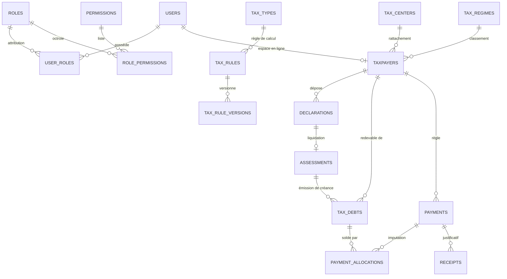

# MNK-TAX — Rapport d'analyse technique (3/3)

> **Partie 3 de 3 — Sections 12 à 15**, puis **INFORMATIONS MANQUANTES** et **ANNEXE POUR MÉMOIRE (A.1 → A.9)**.
>
> - Partie 1 : `RAPPORT_PROJET_1.md` (sections 1 à 5)
> - Partie 2 : `RAPPORT_PROJET_2.md` (sections 6 à 11)

---

## 12. PROBLÈMES ET DETTE TECHNIQUE IDENTIFIÉS

> Constats relevés **dans le code** lors de l'analyse. Ce qui relève de la simple documentation non mise à jour est distingué de ce qui relève du code.

### 12.1 Problèmes bloquants ou à risque

| # | Problème | Localisation | Impact |
|---|---|---|---|
| P-1 | **2 tests en échec** lors du dernier passage (04/10/2026) : `TaxRuleRepositoryResolveTest.uncoveredRegimeFallsBackToGeneric` (`expected RZT-GEN, got RZT-FORF`) et `ComplaintRefundModuleIntegrationTest.searchRefundsWithAdvancedFilters` | `backend/target/surefire-reports` | Bug réel de **priorité de résolution des règles fiscales** (une règle forfaitaire écrase la règle générique) et filtre de remboursement défaillant |
| P-2 | **`SEED_DEMO=true` forcé en production** | `render.yaml` (envVars API) | Le jeu de démonstration (comptes, dettes fictives) est injecté à chaque déploiement en production |
| P-3 | **Valeur par défaut du secret JWT codée en dur** | `backend/src/main/resources/application.yml:57` (`jwt.secret: ${JWT_SECRET:…}` — repli base64 du type `change-me…`) | Si `JWT_SECRET` n'est pas fourni, tous les jetons sont signés avec cette valeur publique |
| P-4 | **Mots de passe temporaires renvoyés dans la réponse HTTP** | `RegistrationService.java:201` (`"Temp@" + UUID…`) | Secret exposé dans la réponse d'approbation d'inscription (à ne jamais logger/afficher) |
| P-5 | **Aucune intégration continue** | Pas de `.github/`, pas de workflow | Rien ne vérifie compilation, tests ou lint à chaque commit |
| P-6 | **Fichiers uploadés non persistants en production** | `render.yaml` : aucun disque persistant (`disk:` absent) ; stockage `data/…` | QR/PDF de quittances, avatars et pièces **perdus à chaque redéploiement** sur le plan gratuit Render |

### 12.2 Fonctionnalités absentes ou inachevées

| # | Absence | Constat |
|---|---|---|
| A-1 | **Réinitialisation de mot de passe oublié** | Aucun endpoint `forgot-password` / `reset-password-token` ; seul `POST /api/users/{id}/reset-password` (par un administrateur) existe |
| A-2 | **Double authentification (MFA)** | Colonne `users.mfa_enabled` et champ `UserDto.mfaEnabled` présents mais **jamais utilisés** : toujours `false`, aucun flux de vérification |
| A-3 | **Verrouillage de compte / anti-force brute** | Aucun compteur d'échecs de connexion (seul le rate-limit HTTP général s'applique) |
| A-4 | **Verrous de concurrence distribués** | Rate-limit et locks en **mémoire JVM** : sans effet multi-instances et remis à zéro au redémarrage |
| A-5 | **i18n partiel** | Infrastructure en place (83 composants `useI18n`, ~850 appels `t()`), mais de nombreux libellés **en dur en français** : ex. `Assessments.tsx:106` « Taxation d'office », `:196-198` « Base imposable / Impôt net / Calculé le », `:361` « Aucun événement tracé. » (~1 347 lignes accentuées hors locales dans `pages/` + `components/`) |
| A-6 | **Exports serveur** | Aucun export Excel/PDF côté API : exports limités au navigateur (`lib/exporters.ts`, `lib/csv.ts`) |
| A-7 | **Cache** | `spring-boot-starter-cache` déclaré + `@EnableCaching`, mais **aucune annotation `@Cacheable`** dans le projet |
| A-8 | **Redis** | `spring-boot-starter-data-redis` + service `redis` dans `docker-compose.yml`, **jamais sollicité** (0 utilisation applicative, exclusion auto-config hors profil `docker`) |

### 12.3 Dette de conception et de code

| # | Constat | Détail |
|---|---|---|
| D-1 | **Double préfixe / double endpoint** | `AuthController.changePassword` (`POST /api/auth/change-password`) et `UserController.changePassword` (`POST /api/users/change-password`) réalisent la même opération |
| D-2 | **Chemins incohérents** | `PaymentPlanController` exposé sous `/api/collection/plans` (paquet `paymentplan`) ; `CollectionController` gère `/api/collection/payment` (encaissement) |
| D-3 | **Swagger et console H2 en `permitAll`** | `/swagger-ui/**`, `/v3/api-docs/**` et `/h2-console/**` figurent dans la liste publique (`SecurityConfig.java:66`) ; désactivés seulement si `EXPOSE_API_DOCS=false` (le cas du profil `prod`, mais **pas** la valeur par défaut) |
| D-4 | **Contrôleur IA sans contrôle de permission** | `AiController.chat` n'a pas de `@PreAuthorize` : tout compte authentifié peut l'appeler (le service interdit seulement l'accès aux statistiques globales sans `REPORT_READ`) |
| D-5 | **`audit_logs` sans clé étrangère** | `user_id` non référencé : cohérence non garantie avec `users` |
| D-6 | **Colonnes orphelines** | `users.mfa_enabled` (jamais exploité), `receipts.download_count` (incrémenté seulement si le service le fait), `system_parameters` non typé (tout en `VARCHAR`) |
| D-7 | **Schéma hétérogène en langage** | Mélange de libellés anglais (`reference`, `status`) et français (`nom`, `fichier`, `obligatoire`, `ancien_statut`) selon les migrations |
| D-8 | **`docs/` désynchronisé du code** | Voir section 15 |

### 12.4 Points positifs à valoriser dans le mémoire

- Schéma géré exclusivement par **migrations versionnées** (36 fichiers, jamais de `ddl-auto: update` en production).
- **`BigDecimal` partout** pour les montants, arrondis explicites `HALF_UP`.
- **Versionnage des règles fiscales** (`tax_rule_versions`) et impression de la version utilisée dans chaque imposition (`rule_code`, `rule_version`) : calcul reproductible.
- **Traçabilité exhaustive** : `audit_logs`, `declaration_histories`, `assessment_history`, `debt_history`.
- **Architecture modulaire** par domaine (22 paquets), testable (`@SpringBootTest` sur H2 sans Docker).
- **RBAC fin** (90 permissions) couvrant l'ensemble des 228 endpoints.
- Communication **multicanal avec file de reprise** (tentatives, backoff, erreurs journalisées).

---

## 13. DÉPLOIEMENT

### 13.1 Profils Spring (`backend/src/main/resources/`)

| Profil | Fichier | But |
|---|---|---|
| **dev** (défaut) | `application-dev.yml` | H2 en mémoire (`jdbc:h2:mem:mnktax;MODE=PostgreSQL`), seed de démonstration, Swagger ouvert, console H2 |
| **test** | `application-test.yml` | H2 dédié aux tests d'intégration, rate-limit assoupli |
| **docker** | `application-docker.yml` | PostgreSQL du `docker-compose`, Redis activé (mais non utilisé), seed activé |
| **prod** | `application-prod.yml` | PostgreSQL managé, seed désactivable, `ssl` délégué au proxy |
| **render** | `application-render.yml` | Render free (port `SERVER_PORT`, `JAVA_OPTS` 256–384 Mo), uploads 10 MB, chemins `data/…` |
| — | `application.yml` | Commun : Flyway `baseline-on-migrate`, `ddl-auto: validate`, JWT (TTL 1 h/7 j), rate-limit 120 req/min, multipart 10 MB |

Activation : `SPRING_PROFILES_ACTIVE` (sur Render : `render`).

### 13.2 Environnement local (Docker)

`docker-compose.yml` — **4 services** :

| Service | Image / build | Port (`.env.example`) | Rôle |
|---|---|---|---|
| `postgres` | `postgres:16-alpine` | `POSTGRES_PORT` | Base de données, volume `pgdata` |
| `redis` | `redis:7-alpine` | `REDIS_PORT` | **Déclaré mais non utilisé** par le code |
| `backend` | `build: ./backend` | `BACKEND_PORT` | API Spring Boot (`8080`), dépend de `postgres` |
| `frontend` | `build: ./frontend` | `FRONTEND_PORT` | nginx servant React + proxy `/api` |

Commandes (README) : `docker compose up -d` ; ou sans Docker : `cd backend && ./mvnw spring-boot:run` (H2) puis `cd frontend && npm install && npm run dev` (port **5177**, proxy vers `8080`).

### 13.3 Production — Render + Neon

**`render.yaml` (blueprint, 2 services)** :

| Service | Type | Configuration |
|---|---|---|
| `mnk-tax-api` | `web`, runtime **docker**, `rootDir: backend`, plan `free` | `SPRING_PROFILES_ACTIVE=render`, `DATABASE_URL` (secret), `JWT_SECRET` (valeur générée par Render), `CORS_ALLOWED_ORIGINS` et `RECEIPT_BASE_URL` = URL du front, **`SEED_DEMO="true"`**, `SERVER_PORT=10000`, `JAVA_OPTS=-Xms256m -Xmx384m…`, `healthCheckPath=/actuator/health` |
| `mnk-tax-frontend` | `static`, `rootDir: frontend` | `buildCommand: npm run build`, `staticPublishPath: dist`, rewrite `/* → /index.html` (SPA), `VITE_API_BASE_URL` = URL de l'API |

- **Base de données** : **Neon** (PostgreSQL managé), branché par `DATABASE_URL` via `RenderDataSourceConfig` (profil `prod`/`render`).
- **TLS** : porté par Render et Neon (aucun `server.ssl` côté Spring).
- **Répertoire supplémentaire** : `deploy/render/` (Dockerfile unique, `nginx.template`, `start.sh`, `render.yaml`, `smoke-test.ps1`) pour le déploiement « tout-en-un ».
- **Limites à connaître** : plan gratuit (service en veille après inactivité, **aucun disque persistant** → fichiers perdus au redéploiement, `JAVA_OPTS` plafonné à 384 Mo).

### 13.4 Variables d'environnement (noms uniquement — `.env.example`, 35 variables uniques)

| Bloc | Noms de variables |
|---|---|
| **Ports et base** | `POSTGRES_PORT`, `POSTGRES_DB`, `POSTGRES_USER`, `POSTGRES_PASSWORD`, `REDIS_PORT`, `BACKEND_PORT`, `FRONTEND_PORT` |
| **Application** | `JWT_SECRET`, `SEED_DEMO`, `RECEIPT_BASE_URL` |
| **Courriel (SMTP)** | `MAIL_HOST`, `MAIL_PORT`, `MAIL_USERNAME`, `MAIL_PASSWORD`, `MAIL_SMTP_AUTH`, `MAIL_SMTP_STARTTLS`, `MAIL_FROM_ADDRESS`, `MAIL_FROM_NAME`, `MAIL_BASE_URL` |
| **SMS (Twilio)** | `SMS_PROVIDER` (x2), `SMS_ACCOUNT_SID`, `SMS_AUTH_TOKEN`, `SMS_FROM_NUMBER` |
| **File de communication** | `COMM_QUEUE_BATCH_SIZE`, `COMM_QUEUE_MAX_ATTEMPTS`, `COMM_QUEUE_RETRY_BACKOFF_MINUTES`, `COMM_QUEUE_POLL_DELAY_MS`, `COMM_TEST_EMAIL`, `COMM_TEST_SMS`, `COMM_DEMO_PROVIDER`, `COMM_SCHEDULER_CRON` |
| **Planificateurs** | `OVERDUE_SCHEDULER_CRON`, `DEADLINE_SCHEDULER_CRON`, `SCHEDULER_TIMEZONE`, `SCHEDULER_POOL_SIZE` |
| **Auto-paramétrés** | `SPRING_PROFILES_ACTIVE`, `DATABASE_URL`, `CORS_ALLOWED_ORIGINS`, `VITE_API_BASE_URL`, `SERVER_PORT`, `JAVA_OPTS`, `RATE_LIMIT_ENABLED`, `RATE_LIMIT_PER_MINUTE`, `EXPOSE_API_DOCS`, `JWT_ACCESS_TTL`, `JWT_REFRESH_TTL` |

> Aucune valeur secrète n'est reproduite ici ; les valeurs par défaut non sécurisées du code applicatif sont signalées en §12 et annexe A.9.

### 13.5 Procédure de build et de publication

```bash
# 1. Backend — tests puis JAR
cd backend && ./mvnw test && ./mvnw package -DskipTests     # → target/mnk-tax*.jar

# 2. Frontend — type-check, lint, tests, build
cd frontend && npm install
npm run lint && npm run test
npm run build                                                # tsc -b && vite build → dist/

# 3. Conteneurs
docker compose up -d --build

# 4. Production
git push origin main      # Render détecte le commit et reconstruit (blueprint render.yaml)
```

- **Santé de l'API** : `GET /actuator/health` (point de contrôle Render).
- **Smoke test** : `deploy/render/smoke-test.ps1`.
- **Rollback** : redéploiement de l'image précédente côté Render ; côté base, Flyway **ne régresse pas** (pas de `undo`) → migration irreversible à valider avant production.

---

## 14. DÉTAIL DES DÉPENDANCES

### 14.1 Backend (`backend/pom.xml`)

**Dépendances applicatives**

| Dépendance | Version | Utilisée ? | Usage réel dans le code |
|---|---|---|---|
| `spring-boot-starter-parent` | 3.3.5 | ✅ | Gestion des versions et plugins |
| `spring-boot-starter-web` | BOM | ✅ | 27 contrôleurs REST, Tomcat, Jackson |
| `spring-boot-starter-data-jpa` | BOM | ✅ | 52 `@Entity`, repositories Spring Data |
| `spring-boot-starter-security` | BOM | ✅ | `SecurityConfig`, JWT, `@PreAuthorize` (211) |
| `spring-boot-starter-validation` | BOM | ✅ | 49 `@Valid` sur les DTO d'entrée |
| `spring-boot-starter-actuator` | BOM | ✅ | `/actuator/health` (health-check Render) |
| `spring-boot-starter-cache` | BOM | ⚠️ **Déclarée mais inutilisée** | `@EnableCaching` présent, **0 `@Cacheable`** |
| `spring-boot-starter-data-redis` | BOM | ⚠️ **Déclarée mais inutilisée** | Aucun accès Redis applicatif (exclu des profils hors `docker`) |
| `spring-boot-starter-mail` | BOM | ✅ *si SMTP configuré* | `SmtpEmailProvider` (désactivé sans `MAIL_HOST`) |
| `com.twilio.sdk:twilio` | 13.0.1 | ✅ *si configuré* | `TwilioSmsProvider` (`SMS_PROVIDER=twilio`) — `none` par défaut |
| `flyway-core` + `flyway-database-postgresql` | BOM | ✅ | 36 migrations appliquées au démarrage |
| `org.postgresql:postgresql` | runtime | ✅ | Production (Neon) |
| `com.h2database:h2` | runtime | ✅ | Dev et tests (mémoire) |
| `jjwt-api` / `jjwt-impl` / `jjwt-jackson` | 0.12.6 | ✅ | Émission/vérification JWT |
| `springdoc-openapi-starter-webmvc-ui` | 2.6.0 | ✅ | Swagger UI (activable `EXPOSE_API_DOCS`) |
| `com.google.zxing:core` + `javase` | 3.5.3 | ✅ | QR codes des quittances |
| `com.github.librepdf:openpdf` | 1.3.40 | ✅ | PDF : quittance, avis, mise en demeure, relance, état des restes |
| `org.projectlombok:lombok` | BOM | ✅ | Builders/getters sur les entités |

**Dépendances de test** : `spring-boot-starter-test` (JUnit 5, AssertJ, MockMvc), `spring-security-test`.

**Plugins** : `maven-compiler-plugin`, `spring-boot-maven-plugin`, `jacoco-maven-plugin` **0.8.12** (couverture : 40,7 % instructions — §11.3).

### 14.2 Frontend (`frontend/package.json`)

**Dépendances d'exécution (14)**

| Dépendance | Version | Utilisée ? | Usage |
|---|---|---|---|
| `react`, `react-dom` | ^19.2.8 | ✅ | Runtime d'interface |
| `react-router-dom` | ^7.18.2 | ✅ | 38 routes (`App.tsx`) |
| `@tanstack/react-query` | ^5.101.4 | ✅ | 289 `useQuery`, 172 `useMutation` |
| `axios` | ^1.19.0 | ✅ | `lib/api.ts` : Bearer, refresh, `Accept-Language` |
| `tailwindcss`, `@tailwindcss/vite` | ^4.3.3 | ✅ | Styles (config CSS-first) |
| `zod` | ^4.4.3 | ✅ | Validation des formulaires |
| `react-hook-form` | ^7.85.0 | ✅ | Formulaires (connexion, inscription, contribuables, créances) |
| `@hookform/resolvers` | ^5.8.0 | ✅ | Pont zod ↔ react-hook-form |
| `recharts` | ^3.10.1 | ✅ | Graphiques des tableaux de bord et rapports |
| `lucide-react` | ^1.31.0 | ✅ | Icônes (menu, boutons) |
| `motion` | ^13.4.0 | ✅ **limitée** | Uniquement dans `components/AiAssistant.tsx` (et animations d'accueil) |
| `react-markdown` | ^10.1.0 | ✅ | Rendu des réponses de l'assistant |

**Dépendances de développement (12)** : `vite` ^8.2.0, `@vitejs/plugin-react` ^6.0.4, `typescript` ~6.0.2, `vitest` ^4.1.11, `jsdom` ^30.0.1, `@testing-library/react` ^16.3.3, `@testing-library/jest-dom` ^7.0.1, `@testing-library/user-event` ^14.6.6, `oxlint` ^1.75.0, `@types/node`, `@types/react`, `@types/react-dom`.

**Absences notables** : ESLint/ESLint-plugin-React, i18next (i18n maison), librairie de composants UI, librairie d'export (Excel/PDF), MSW, Cypress/Playwright, axios-retry.

### 14.3 Infrastructure

| Élément | Version | Utilisation |
|---|---|---|
| PostgreSQL | 16 | Prod (Neon) et `docker-compose` |
| H2 | — | Dev/test |
| Redis | 7 | Présent dans `docker-compose` mais **jamais appelé par le code** |
| nginx | 1.27-alpine | Service `frontend` et déploiement Render : SPA + proxy `/api` |
| Node | 24 (builder Docker) / 22+ | Build et tests frontend |
| JRE | 17 (eclipse-temurin) | Exécution du backend |
| Docker | multi-stage | `backend/Dockerfile`, `frontend/Dockerfile`, `deploy/render/Dockerfile` |

---

## 15. SOURCES ET ÉCARTS DOCUMENTATION / CODE

### 15.1 Documentation disponible (`docs/`, 10 fichiers)

| Fichier | Lignes | Contenu | Fiabilité constatée |
|---|---:|---|---|
| `ARCHITECTURE.md` | 91 | Vision 3 tiers, paquets, flux | ✅ cohérent |
| `API.md` | 322 | Endpoints principaux | ⚠️ incomplet (228 endpoints réels) |
| `DATABASE.md` | 59 | Tables, rôles, contraintes | ⚠️ **rôles au nombre de 5 (6 réels), contrôle de clé NIF annoncé mais absent** |
| `SECURITY.md` | 42 | JWT, RBAC, BCrypt | ✅ cohérent |
| `DEPLOYMENT.md` | 58 | Déploiement générique | ✅ |
| `DEPLOYMENT-RENDER.md` | 162 | Render + Neon | ✅ |
| `FAKE_DATA_DOCUMENTATION.md` | 330 | Jeu de démonstration | ⚠️ chiffres à revalider |
| `ACCESS_MATRIX.md` | 122 | Matrice rôles/permissions | Récent (ajout du dépôt) |
| `analyse_memoire.md` | 679 | Analyse orientée mémoire | Récent (ajout du dépôt) |
| `fake-data-seed.json` | 182 | Jeu de démonstration structuré | ✅ source fiable pour l'annexe A.4 |
| `README.md` | — | Présentation, démarrage | ⚠️ « **35 tests** » (196 réels), **5 comptes listés (6 réels)**, mention « IA » sans précision |

### 15.2 Écarts documentations ↔ code

| # | Document dit | Le code fait | Verdict |
|---|---|---|---|
| 1 | `DATABASE.md` : contrôle de clé **NIF mod 97** | Regex `^[0-9]{10}$` seule (`NifValidator.java`) | **Écart : contrôle non implémenté** |
| 2 | `DATABASE.md` : **5 rôles** | **6 rôles** (ajout de `ADMIN`) | **Écart documentaire** |
| 3 | `README.md` : **35 tests** | **196 exécutions** (2 en échec) | **Écart documentaire** |
| 4 | `README.md` : **5 comptes** de démonstration | **6 comptes** (`superadmin` non listé) | **Écart documentaire** |
| 5 | `README.md` / bandeau « **IA** », « assistant intelligent » | Moteur de **règles + appariement textuel** (Levenshtein) — **aucun LLM**, aucun appel réseau de modèle | **Écart sémantique : à expliciter dans le mémoire** |
| 6 | `docs/ARCHITECTURE.md` : « mise en cache » | `@EnableCaching` sans `@Cacheable` | **Non implémenté** |
| 7 | `docker-compose` : Redis | Jamais utilisé par l'application | **Service superflu** |
| 8 | `infra/nginx/` annoncé dans l'arborescence | Répertoire **vide** | **Absent** |
| 9 | MFA (colonne, champ DTO) | Aucun flux | **Non implémenté** |
| 10 | Tailwind « configuration » | Tailwind **v4**, configuration dans le CSS (pas de `tailwind.config`) | Documentation à mettre à jour |

---

## INFORMATIONS MANQUANTES

> Éléments recherchés dans le dépôt et **introuvables** — à obtenir auprès de l'encadrant ou du porteur du projet, ou à assumer explicitement comme limites du prototype.

| # | Information recherchée | Où cherché | Statut |
|---|---|---|---|
| 1 | **Script SQL unique de création de la base** (`schema.sql`, `create.sql`, `init.sql`) | Racine, `backend/src/main/resources`, `docs/` | **NON TROUVÉ** — le schéma résulte des 36 migrations Flyway (script du socle au §4.6) |
| 2 | **Références légales** (articles de loi, arrêtés, taux officiels) pour chaque règle fiscale | `tax_rules.legal_reference`, `docs/`, `README` | **NON TROUVÉ** — seules des mentions génériques (« Règle de calcul de référence », « Repli générique ») et `is_demo = true` |
| 3 | **Tests de charge / performance** | `docs/`, scripts, Maven | **NON TROUVÉ** |
| 4 | **Intégration continue / pipeline** | `.github/`, `.gitlab-ci.yml`, `Jenkinsfile` | **NON TROUVÉ** |
| 5 | **Tests E2E** (Cypress, Playwright) | `frontend/` | **NON TROUVÉ** |
| 6 | **Charte graphique / maquettes** (Figma, PNG) | `docs/`, `frontend/public/` | **NON TROUVÉ** (seuls des visuels `hero/` et `FiscalAnimation`) |
| 7 | **Cahier des charges / spécifications formelles** | Racine, `docs/` | **NON TROUVÉ** (le `README.md` tient lieu de cahier des charges) |
| 8 | **Jeu de données de production / volumétrie attendue** | — | **NON TROUVÉ** |
| 9 | **Procédure de sauvegarde / restauration** de la base | `docs/` | **NON TROUVÉ** |
| 10 | **Mot de passe oublié** (procédure utilisateur) | `auth` | **NON IMPLÉMENTÉ** (voir A.7) |
| 11 | **Politique de rétention des données personnelles** (hors audit) | `docs/SECURITY.md` | **NON TROUVÉ** |
| 12 | **Horaires/engagement de service (SLA)**, budget d'infrastructure | — | **NON TROUVÉ** |
| 13 | **Mots de passe des comptes de démonstration** | — | **Volontairement absents de ce rapport** (présents dans `README.md` et `DemoDataSeeder.java` : à ne pas diffuser) |
| 14 | **Couverture de code visée** (seuil qualité) | CI, `pom.xml` | **NON TROUVÉ** (aucun seuil imposé) |

---
---

# ANNEXE POUR MÉMOIRE

> Éléments directement réutilisables dans un mémoire de L3 : modèle conceptuel, règles fiscales sourcées, scénarios de test, données de démonstration, extraits de code, glossaire, complétude, classification des dépendances et recommandations.

---

## A.1 — Modèle conceptuel simplifié (12 tables maximum) et regroupement par domaine

### A.1.1 Regroupement des 53 tables par domaine

| Domaine (paquet Java) | Nombre | Tables |
|---|---:|---|
| **Sécurité & annuaire** (`auth`, `security`) | 6 | `users`, `roles`, `permissions`, `user_roles`, `role_permissions`, `refresh_tokens` |
| **Contribuables** (`taxpayer`) | 5 | `taxpayers`, `taxpayer_addresses`, `taxpayer_activities`, `tax_centers`, `tax_regimes` |
| **Référentiel fiscal** (`tax`) | 3 | `tax_types`, `tax_obligations`, `deadlines` |
| **Règles de calcul** (`tax/engine`) | 2 | `tax_rules`, `tax_rule_versions` |
| **Déclarations** (`declaration`) | 4 | `declarations`, `declaration_lines`, `declaration_annexes`, `declaration_histories` |
| **Impositions** (`assessment`) | 5 | `assessments`, `assessment_lines`, `assessment_history`, `penalties`, `interests` |
| **Créances & recouvrement** (`debt`, `collection`, `paymentplan`) | 8 | `tax_debts`, `debt_items`, `debt_history`, `collection_actions`, `collection_notices`, `payment_plans`, `payment_plan_installments`, `debt_disputes` |
| **Paiements & quittances** (`payment`, `receipt`, `refund`) | 4 | `payments`, `payment_allocations`, `receipts`, `refunds` |
| **Contrôle & contentieux** (`control`, `complaint`) | 4 | `tax_controls`, `control_documents`, `complaints`, `complaint_responses` |
| **Communication & notifications** (`message`, `communication`, `notification`) | 8 | `messages`, `message_attachments`, `message_deliveries`, `message_templates`, `campaigns`, `campaign_recipients`, `communication_event_rules`, `notifications` |
| **Transverse** (`document`, `audit`, `administration`) | 4 | `documents`, `audit_logs`, `system_parameters`, `registration_requests` |
| **Total** | **53** | |

### A.1.2 MCD simplifié (12 entités)



**Légende des 12 entités retenues** : `users`/`roles`/`permissions` (sécurité), `taxpayers` (+ régimes/centres), `tax_types`, `tax_rules`, `declarations`, `assessments`, `tax_debts`, `payments`, `payment_allocations`, `receipts`.
> Les 41 autres tables sont des tables de détail, d'historique ou de communication ; leur description complète figure au §4.3.

---

## A.2 — Règles fiscales détaillées (prêtes à citer)

> **Aucune référence légale exploitable n'a été trouvée dans le code** : la colonne `tax_rules.legal_reference` ne contient que des mentions génériques et la base est amorcée en `is_demo = true`. Pour chaque règle, la colonne « Source » indique donc `SOURCE NON TROUVÉE` — **ne pas inventer d'article de loi**.

### A.2.1 Règles de calcul immposition (seedées par `DemoDataSeeder.seedRules()`, `DemoDataSeeder.java:546-569`)

| Code | Libellé | Type d'impôt | Méthode | Taux / valeur | Périmètre | Fichier / ligne | Source légale |
|---|---|---|---|---|---|---|---|
| `R-TVA-20` | TVA taux unique | TVA | `PERCENTAGE_OF_BASE` | **20 %** | `COMPANY` + régime `REG-REEL`, dès le 01/01/2024 | `DemoDataSeeder.java:548` | **SOURCE NON TROUVÉE** (`legal_reference` = « Règle de calcul de référence », `is_demo = true`) |
| `R-TVA-20-GEN` | TVA taux unique (tous régimes) | TVA | `PERCENTAGE_OF_BASE` | **20 %** | Repli générique (aucun périmètre) | `DemoDataSeeder.java:551` | **SOURCE NON TROUVÉE** (« Repli générique : aucun régime réel configuré ») |
| `R-IS-25` | IS taux | IS | `PERCENTAGE_OF_BASE` | **25 %** | `COMPANY` + `REG-REEL` | `DemoDataSeeder.java:554` | **SOURCE NON TROUVÉE** |
| `R-IS-25-GEN` | IS taux (tous régimes) | IS | `PERCENTAGE_OF_BASE` | **25 %** | Repli générique | `DemoDataSeeder.java:557` | **SOURCE NON TROUVÉE** |
| `R-IRSA-15` | IRSA taux | IRSA | `PERCENTAGE_OF_BASE` | **15 %** | `PERSON` (tous régimes) | `DemoDataSeeder.java:560` | **SOURCE NON TROUVÉE** |
| `R-IR-20` | IR taux progressif | IR | `PROGRESSIVE` | Barème : **0 % jusqu'à 50 000 000 Ar**, **10 % de 50 000 001 à 100 000 000 Ar**, **20 % au-delà** | Tous types / régimes | `DemoDataSeeder.java:563`, tranches en `:572-573` | **SOURCE NON TROUVÉE** (« Barème progressif de référence (seuils marginaux) ») |
| `R-IFT-2` | IFT taux | IFT | `PERCENTAGE_OF_BASE` | **2 %** | Tous types / régimes | `DemoDataSeeder.java:566` | **SOURCE NON TROUVÉE** |

### A.2.2 Majorations de retard (`DemoDataSeeder.seedPenalties()`, `:599-612`)

| Code | Libellé | Valeur | Formule appliquée | Fichier / ligne | Source |
|---|---|---|---|---|---|
| `PEN_DEMO_5` | Pénalité de retard 5 % | **5 %** | `pénalité = solde × 5 / 100` (appliquée **une seule fois** par créance) | `DemoDataSeeder.java:601-605` + `DebtService.applyLateCharges` (`DebtService.java:291-300`) | **SOURCE NON TROUVÉE** |
| `INT_DEMO_1` | Intérêt de retard 1 %/mois | **1 % / mois** | `intérêts = solde × 1 × max(1, nombre de mois) / 100` | `DemoDataSeeder.java:607-610` + `DebtService.java:305-316` | **SOURCE NON TROUVÉE** |

### A.2.3 Paramètres système associés (`system_parameters`, amorcés en `:315-319`)

| Clé | Valeur | Usage |
|---|---|---|
| `VAT_RATE` | `20` | Taux de TVA de référence affiché dans l'IHM |
| `PENALTY_RATE` | `5` | Taux de pénalité par défaut |
| `INTEREST_RATE_MONTHLY` | `1` | Taux d'intérêt mensuel par défaut |
| `DEBT.DEFAULT_PENALTY_CODE` | `PEN_DEMO_5` | Code de pénalité appliqué par `applyLateCharges` |
| `DEBT.DEFAULT_INTEREST_CODE` | `INT_DEMO_1` | Code d'intérêt appliqué par `applyLateCharges` |

### A.2.4 Formules de calcul (code source : `tax/engine/TaxCalculator.java`)

| Méthode | Formule | Ligne |
|---|---|---|
| `FLAT_RATE`, `PERCENTAGE_OF_BASE`, `PERCENTAGE_OF_TURNOVER` | `brut = assiette × taux / 100` (arrondi `HALF_UP` à 2 décimales) | `TaxCalculator.java:61-62` |
| `PROGRESSIVE` | somme sur chaque tranche : `portion × taux_tranche / 100` (JSON `brackets`) ; repli sur taux unique si tranches absentes/vides | `:82-125` |
| `PER_UNIT` | `brut = taux × assiette` | `:64` |
| Plancher / plafond | `brut = max(brut, minimum)` puis `brut = min(brut, maximum)` | `:132-143` |
| **Net** | `net = brut − exonération − déduction` | `:54-56` |

> **Rappel pour le mémoire** : ces taux sont des **valeurs de démonstration pédagogique** (`is_demo = true`), non opposables ; toute mise en production exigerait leur calibration avec la législation malgache en vigueur (**référence à obtenir** — voir INFORMATIONS MANQUANTES, ligne 2).

---

## A.3 — Scénarios de test réutilisables

> Chaque scénario est rédigé pour être **repris tel quel** dans un mémoire (précondition → étapes → résultat attendu). La dernière colonne indique le **test automatisé correspondant** et son statut au dernier passage (04/10/2026).

| # | Objectif | Précondition | Étapes | Résultat attendu | Test automatisé existant |
|---|---|---|---|---|---|
| **S01** | Authentification et cycle de vie du jeton | Compte `agent.tax` actif | 1. `POST /api/auth/login`<br>2. Appeler `GET /api/auth/me` avec le jeton<br>3. Attendre expiration (ou simuler) puis `POST /api/auth/refresh`<br>4. `POST /api/auth/logout` | 200 + `accessToken`/`refreshToken` ; profil renvoyé ; nouveau couple de jetons ; le refresh révoqué ne fonctionne plus | `AuthFlowIntegrationTest` (7) ✅ |
| **S02** | Contrôle d'accès fin (RBAC) | Connecté avec un rôle sans permission `USER_READ` | 1. `GET /api/users/` | **403** avec `code: ACCESS_DENIED` et corps `ApiError` standardisé | `ProfileModuleIntegrationTest$RBAC` (5) ✅ |
| **S03** | Flux complet déclaration → imposition → créance | Contribuable actif, type d'impôt `TVA`, règle `R-TVA-20` active | 1. `POST /api/declarations` (assiette > 0)<br>2. `PUT …/submit`<br>3. `PUT …/review` puis `PUT …/validate`<br>4. Consulter `GET /api/assessments` | Statuts `DRAFT→SUBMITTED→UNDER_REVIEW→VALIDATED→LIQUIDEE` ; imposition créée avec `rule_code`/`rule_version` ; créance `tax_debts` créée à `ISSUED` avec `balance = montant dû` | `FiscalFlowIntegrationTest` (4) ✅ |
| **S04** | Calcul linéaire (TVA) | Règle `R-TVA-20` (20 %) | Calculer sur assiette `1 000 000,00` | `brut = 200 000,00`, `net = 200 000,00` (arrondi 2 décimales `HALF_UP`) | `TaxCalculatorTest` (14) ✅ |
| **S05** | Barème progressif (IR) | Règle `R-IR-20` avec tranches 0/10/20 % | Calculer sur assiette `120 000 000` | Tranche 1 : 0 % sur 50 M ; tranche 2 : 10 % sur 50 M = 5 M ; tranche 3 : 20 % sur 20 M = 4 M → **brut = 9 000 000** | `TaxCalculatorTest` ✅ |
| **S06** | Sélection de règle avec repli générique | Règle spécifique absente pour le régime du contribuable | Appeler le résolveur pour ce contribuable | Retour de la règle **générique** (`…-GEN`) et non d'une règle hors périmètre | `RuleResolverTest` (6) ✅ — `TaxRuleRepositoryResolveTest.uncoveredRegimeFallsBackToGeneric` ❌ **échec** |
| **S07** | Validation du NIF | — | Saisir `1234567890` (10 chiffres), puis `123456789` (9) et `123456789A` | Valide pour 10 chiffres ; rejet pour les autres *(aucun contrôle de clé mod 97)* | `NifValidatorTest` (16) ✅ |
| **S08** | Normalisation du téléphone | — | Saisir `034 12 345 67` puis `+261341234567` | Les deux aboutissent à `+261341234567` (`phone_normalized`) | `PhoneUtilTest` (6) ✅ |
| **S09** | Encaissement et imputation multiple | Paiement de 500 000 sur une créance de 300 000 (principal 250 000, pénalité 30 000, intérêts 20 000) | 1. `POST /api/payments`<br>2. `PUT /api/payments/{id}/allocate` | Imputation dans l'ordre **principal → pénalité → intérêts** ; `ALLOCATION_MISMATCH` si la somme diffère ; statut `ALLOCATED` ou `PARTIALLY_ALLOCATED` | `CollectionModuleIntegrationTest` (8) ✅ |
| **S10** | Émission et vérification d'une quittance | Paiement entièrement imputé | 1. Émettre la quittance<br>2. Lire `GET /api/receipts/{id}/pdf` et le QR<br>3. **Sans connexion** : `GET /api/receipts/verify/{token}` | QR + PDF générés ; `receipt_number` unique ; vérification publique renvoie la quittance **VALID** | `ReceiptServiceTest` (18) ✅ |
| **S11** | Annulation / remplacement de quittance | Quittance `ISSUED` | 1. `PUT /api/receipts/{id}/cancel` (avec motif)<br>2. `POST /api/receipts/{id}/replace` | Statut `CANCELLED` puis `REPLACED` ; `replaced_by_reference` renseigné ; l'ancien jeton ne doit plus valider | `ReceiptServiceTest` ✅ |
| **S12** | Créance échue et majorations | Créance `ISSUED` avec `due_date < aujourd'hui` | 1. Exécuter `POST /api/debts/mark-overdue`<br>2. Contrôler `debt_items` et `debt_history`<br>3. Réexécuter la commande | Statut `OVERDUE` ; pénalité 5 % et intérêts 1 % × mois ajoutés **une seule fois** ; événement de communication émis | `CollectionModuleIntegrationTest` ✅ |
| **S13** | Échéancier et échéances impayées | Créance soldable de 1 200 000 | 1. `POST /api/collection/plans` (3 échéances)<br>2. Exécuter le marquage des retards | `payment_plans` `ACTIVE` ; échéances `PENDING` → `OVERDUE` si date passée ; `COMPLETED` quand tout est payé | `PaymentPlanIntegrationTest` (8) ✅ |
| **S14** | Contrôle fiscal et redressement | Contribuable et créance existants | 1. `POST /api/tax-controls/`<br>2. Ajouter des pièces (`control_documents`)<br>3. `PATCH …/close` avec redressement | Cycle `OPEN→…→CLOSED` ; `redressement` et `penalty_amount` renseignés ; créance liée `tax_controls.debt_id` créée | `TaxControlModuleIntegrationTest` (5) ✅ |
| **S15** | Réclamation puis remboursement | Déclaration soldée | 1. `POST /api/complaints/`<br>2. `POST …/responses`<br>3. `PATCH /api/refunds/{id}/review` puis `…/pay` | Réclamation `OPEN→…→CLOSED` ; remboursement `PENDING→APPROVED→PAID` avec montant approuvé | `ComplaintRefundModuleIntegrationTest` (10, **1 échec sur les filtres avancés**) ⚠️ |
| **S16** *(bonus)* | Communication multicanal et reprise | `MAIL_HOST` non configuré (défaut) | 1. `POST /api/communication/send`<br>2. Consulter `GET …/messages/{id}/deliveries` | `message_deliveries` `PENDING` → `FAILED` avec `last_error`, `attempt_count < max_attempts`, prochaine tentative planifiée | `CommunicationLifecycleIntegrationTest` (7) ✅ |

---

## A.4 — Données de démonstration

> Source : `DemoDataSeeder.java` (25 méthodes `seed*`) et `docs/fake-data-seed.json`. **Aucun mot de passe n'est reproduit ci-dessous** : les identifiants sont publics, les secrets restent dans `README.md` et `DemoDataSeeder.java`.

### A.4.1 Comptes et rôles (`seedUsers()`, `DemoDataSeeder.java:474-481`)

| Identifiant | Nom affiché | Rôle | E-mail |
|---|---|---|---|
| `superadmin` | Super Admin | `SUPER_ADMIN` | `superadmin@mnk-tax.mg` |
| `admin` | Admin | `ADMIN` | `admin@mnk-tax.mg` |
| `agent.tax` | Agent Fiscal | `TAX_AGENT` | `agent.tax@mnk-tax.mg` |
| `agent.collection` | Agent Recouvrement | `COLLECTION_AGENT` | `agent.collection@mnk-tax.mg` |
| `accountant` | Comptable | `ACCOUNTANT` | `accountant@mnk-tax.mg` |
| `taxpayer.demo` | Contribuable | `TAXPAYER` | `taxpayer@mnk-tax.mg` |

> **Mot de passe** : paramètre de la méthode `createUser(...)`, **non communiqué ici** (voir `DemoDataSeeder.java:475-480` et `README.md`).

### A.4.2 Rôles et permissions

| Élément | Contenu |
|---|---|
| **6 rôles** | `SUPER_ADMIN`, `ADMIN`, `TAX_AGENT`, `COLLECTION_AGENT`, `ACCOUNTANT`, `TAXPAYER` (`seedRoles()`, `:400`) |
| **90 permissions** | Constantes Spring `PERMISSION_*` (`Permissions.java`) ; 66 insérées par `seedPermissions()` (`:333`), complétées par les migrations `V19`, `V21`, `V35` |

### A.4.3 Jeu de données métier (`docs/fake-data-seed.json`)

| Objet | Quantité | Détail |
|---|---:|---|
| Utilisateurs | 6 | Voir A.4.1 |
| Centres fiscaux | 3 | `CEN-001` Analakely, `CEN-002` Antanimena, `CEN-003` Toamasina (`seedReferences()`, `:506-511`) |
| Régimes | 3 | `REG-REEL` (réel, mensuel, TVA/IS/IRSA), `REG-SIMP` (simplifié, trimestriel), `REG-FORF` (forfaitaire, annuel, IFT) (`:514-525`) |
| Types d'impôts | 9 | `IR`, `IS`, `IRSA`, `TVA`, `IPVI`, `DE`, `DA`, `IFT`, `IFPB` (`:528-536`) |
| Règles fiscales | 7 | Voir annexe A.2 |
| Pénalités / intérêts | 2 | `PEN_DEMO_5` (5 %), `INT_DEMO_1` (1 %/mois) |
| Contribuables | 5 | Personnes physiques et morales (ex. « SOCIÉTÉ MALAGASY », « RAKOTO Jean », « GROUPE BEMANGA »…) |
| Obligations fiscales | 9 | Une par type d'impôt |
| Déclarations | 4 | Différents statuts |
| Scénarios de créances | 9 | Dont créances en retard, partiellement payées, en litige |
| Flux de recouvrement | 4 | Actions, avis, états d'avancement |
| Paiements | 6 | Différents modes et statuts |
| Quittances | 6 | Avec QR/PDF |
| Messages | 9 | Fils de discussion à contexte |
| Contrôles fiscaux | 2 | Dont un avec redressement |
| Notifications | 8 | Divers types |
| Éléments d'audit | 11 | Traces d'actions |
| Réclamations / remboursements | 3 / 3 | Différents statuts |
| Avis de recouvrement | 3 | Mises en demeure / relances |
| Documents | 4 | Pièces du contribuable |
| Demandes d'inscription | 10 | En attente, acceptées, rejetées |
| Annexes de déclaration | 3 | Fichiers joints |

**Activation** : automatique au démarrage si `SEED_DEMO=true` (défaut en profil `dev`/`docker`, **et forcé dans `render.yaml`** — voir §12 P-2). Toutes les règles créées portent `is_demo = true` et `created_by = "seed"`.

---

## A.5 — Extrait de code significatif

> Extraits courts, à citer avec leur fichier et leur numéro de ligne.

**1. Formule d'imposition linéaire** — `backend/src/main/java/com/mnktax/tax/engine/TaxCalculator.java:61-64`
```java
case FLAT_RATE, PERCENTAGE_OF_BASE, PERCENTAGE_OF_TURNOVER ->
        base.multiply(rate).divide(ONE_HUNDRED, 2, RoundingMode.HALF_UP);
case PROGRESSIVE -> calculateProgressive(base, rule);
case PER_UNIT    -> rate.multiply(base).setScale(2, RoundingMode.HALF_UP);
```

**2. Net d'imposition (exonération et déduction)** — `TaxCalculator.java:54-56`
```java
gross.setScale(2, RoundingMode.HALF_UP),
        /* deduction / exemption retranchées */
net.setScale(2, RoundingMode.HALF_UP));
```

**3. Pénalité et intérêts de retard** — `backend/src/main/java/com/mnktax/debt/service/DebtService.java:294-310`
```java
BigDecimal penalty = debt.getBalance().multiply(rate)
        .divide(BigDecimal.valueOf(100), 2, RoundingMode.HALF_UP);   // 5 % une seule fois
...
long months = Math.max(1, ChronoUnit.MONTHS.between(debt.getDueDate(), LocalDate.now()));
BigDecimal interest = debt.getBalance().multiply(rate).multiply(BigDecimal.valueOf(months))
        .divide(BigDecimal.valueOf(100), 2, RoundingMode.HALF_UP);   // 1 %/mois
```

**4. Calcul du solde et statut automatique** — `DebtService.java:335-378` (extrait)
```java
BigDecimal total = debt.getPrincipalAmount().add(debt.getPenaltyAmount())
        .add(debt.getInterestAmount())
        .subtract(debt.getAdjustmentsAmount()).subtract(debt.getCreditsAmount());
BigDecimal balance = total.subtract(debt.getPaidAmount());
...
if (balance.signum() == 0)                     debt.setStatus(DebtStatus.PAID);
else if (debt.getPaidAmount().signum() > 0)     debt.setStatus(DebtStatus.PARTIALLY_PAID);
else if (debt.getDueDate().isBefore(today))     debt.setStatus(DebtStatus.OVERDUE);
```

**5. Validation du NIF (10 chiffres, sans clé)** — `backend/src/main/java/com/mnktax/common/util/NifValidator.java`
```java
private static final Pattern NIF_PATTERN = Pattern.compile("^[0-9]{10}$");
```

**6. Chaîne de sécurité (CSRF désactivé, état sans session, points publics)** — `backend/src/main/java/com/mnktax/auth/security/SecurityConfig.java:55-66`
```java
.csrf(AbstractHttpConfigurer::disable)
.cors(cors -> cors.configurationSource(corsConfigurationSource))
.sessionManagement(s -> s.sessionCreationPolicy(SessionCreationPolicy.STATELESS))
...
auth.requestMatchers("/api/auth/login", "/api/auth/refresh", "/api/auth/register").permitAll()
    .requestMatchers("/api/receipts/verify/**").permitAll()
    .requestMatchers("/actuator/health", "/actuator/info").permitAll();
// + Swagger UI et console H2 également en permitAll
```

**7. Contrôle de permission sur un endpoint** — exemple `backend/src/main/java/com/mnktax/taxpayer/controller/TaxpayerController.java`
```java
@PreAuthorize("hasAuthority('" + Permissions.TAXPAYER_READ + "')")
```

**8. Tâche planifiée de détection des retards** — `backend/src/main/java/com/mnktax/common/scheduler/FiscalSchedulerService.java:42-52`
```java
@Scheduled(cron = "${mnk-tax.scheduler.overdue-cron:0 30 6 * * *}",
           zone = "${mnk-tax.scheduler.zone:Indian/Antananarivo}")
... debtService.markOverdue(today, ...);
```

---

## A.6 — Glossaire

| Terme | Définition dans le projet |
|---|---|
| **API REST** | Interface HTTP JSON consommée par le front (`/api/...`) |
| **Assiette (tax_base)** | Base de calcul sur laquelle s'applique le taux d'imposition |
| **Assessment / imposition** | Liquidation formelle du montant dû, issue d'une déclaration ou émise d'office |
| **Barème progressif** | Taux croissants appliqués par tranches (`brackets` JSON) |
| **BCrypt** | Algorithme de hachage des mots de passe utilisé |
| **Claim** | Information portée par le jeton JWT (ex. nom d'utilisateur) |
| **Composante d'imputation** | Part d'un paiement affectée à un type de dû : `PRINCIPAL`, `PENALTY`, `INTEREST` |
| **Contribution / créance (`tax_debts`)** | Montant réclamé à un contribuable, avec solde et historique |
| **Contribuable (`taxpayers`)** | Personne physique ou morale assujettie, identifiée par son NIF |
| **CRUD** | Création, lecture, mise à jour, suppression |
| **Dette / créance fiscale** | Synonyme de `tax_debts` dans le code |
| **DTO** | Objet de transfert entre couches (jamais l'entité JPA directement) |
| **Échéance (`deadline`)** | Date limite de déclaration ou de paiement par type d'impôt et période |
| **Échéancier (`payment_plans`)** | Étalement d'une créance en plusieurs versements |
| **Flyway** | Outil de gestion des migrations SQL versionnées |
| **H2** | SGBD en mémoire utilisé en développement et pour les tests |
| **IBAN / MGA** | Devise de référence du projet : ariary malgache (`payments.currency`) |
| **Imputation (`payment_allocations`)** | Affectation d'un paiement à une créance |
| **J-7 / J-3 / J-1** | Paliers de rappel avant échéance (règles `communication_event_rules`) |
| **JWT** | JSON Web Token : jeton signé portant l'identité de l'utilisateur |
| **Ligne de déclaration (`declaration_lines`)** | Détail chiffré d'une déclaration |
| **Liquidation** | Passage d'une déclaration validée à une imposition puis à une créance |
| **MCD** | Modèle conceptuel de données |
| **NIF** | Numéro d'Identification Fiscale : identifiant à 10 chiffres du contribuable |
| **ORM** | Mapping objet-relationnel (JPA/Hibernate) |
| **Penalty / pénalité** | Majoration forfaitaire de retard (5 %) |
| **Principal** | Montant initial de la créance, hors majorations |
| **Profile (Spring)** | Ensemble de paramètres d'environnement (`dev`, `test`, `docker`, `prod`, `render`) |
| **Quittance (`receipts`)** | Justificatif de paiement avec numéro, QR code et PDF |
| **RBAC** | Contrôle d'accès basé sur les rôles (`roles` ↔ `permissions`) |
| **Rectificative** | Déclaration corrigeant une déclaration antérieure |
| **Redressement** | Correction issue d'un contrôle fiscal, générant une créance |
| **Refresh token** | Jeton long permettant d'obtenir un nouveau jeton d'accès |
| **Règle fiscale (`tax_rules`)** | Paramétrage versionné d'un calcul (taux, méthode, périmètre) |
| **Scheduler / cron** | Tâche exécutée automatiquement selon un calendrier |
| **Seed / seeder** | Injection des données initiales (démonstration) |
| **Swagger / springdoc** | Documentation interactive de l'API |
| **TVA / IS / IR / IRSA / IFT** | Types d'impôts modélisés (voir A.2) |
| **Verrouillage optimiste (`@Version`)** | Détection de concurrence par numéro de version |

---

## A.7 — Analyse de complétude

### A.7.1 Avancement par domaine

| Domaine | Complétude | Commentaire vérifié |
|---|---|---|
| Authentification JWT + refresh | ✅ **Complet** | Login, refresh, logout, sessions révocables, historique de sécurité, BCrypt |
| RBAC (rôles + permissions) | ✅ **Complet** | 6 rôles, 90 permissions, 211 `@PreAuthorize`, gestion des rôles en IHM |
| Gestion des comptes | ⚠️ **Partiel** | Utilisateurs, avatars, réinitialisation **par admin** OK ; **mot de passe oublié absent** ; MFA absent |
| Contribuables | ✅ **Complet** | CRUD, recherche, statuts, NIF, adresses, activités, liaison compte |
| Déclarations | ✅ **Complet** | Cycle de vie complet, rectificative, annexes, historique, calendrier |
| Impositions | ✅ **Complet** | Émission, origines (dont office), ajustement, annulation, avis PDF, historique |
| Moteur de règles | ⚠️ **Partiel** | Calculs (4 méthodes) et versionnage OK ; **résolution en échec sur le repli générique** (test rouge) ; taux sans source légale |
| Créances | ✅ **Complet** | Composantes, majorations, statuts, priorités, observations, historique, création manuelle |
| Recouvrement | ✅ **Complet** | Actions, avis + PDF, litiges, état des restes, événements automatiques |
| Échéanciers | ✅ **Complet** | Plans, échéances, marquage des retards, relances automatiques |
| Paiements | ✅ **Complet** | Enregistrement, confirmation, imputation ordonnée, rapprochement, annulation, rejet |
| Quittances | ⚠️ **Partiel** | Émission, QR, vérification publique, annulation/remplacement OK ; **`pdf_path` jamais renseigné** (PDF régénéré à la volée) |
| Contrôle fiscal | ✅ **Complet** | Ouverture, pièces, anomalies, redressement → créance, clôture |
| Réclamations / remboursements | ⚠️ **Partiel** | Flux complet, mais **filtres avancés en échec** (test rouge) |
| Messagerie interne | ✅ **Complet** | Fils, pièces jointes, contexte métier, archivage, recherche indexée |
| Communication multicanal | ✅ **Complet** | Modèles trilingues, campagnes, file de reprise, règles d'événements configurables |
| Notifications | ✅ **Complet** | Centre de notifications, compteurs, lecture groupée |
| Tableau de bord / rapports | ⚠️ **Partiel** | 9 endpoints de stats ; **exports côté client uniquement** (pas d'export serveur) |
| Audit | ✅ **Complet** | Journal complet (IP, user-agent, avant/après), recherche, purge planifiée |
| Paramètres système | ✅ **Complet** | Lecture/écriture en IHM |
| Multi-langue (IHM) | ⚠️ **Partiel** | 3 locales et ~850 appels `t()`, mais **libellés en dur en français** dans plusieurs pages ; **le serveur ignore `Accept-Language`** |
| Assistant « IA » | ⚠️ **Partiel** | Fonctionnel (règles + appariement) mais **sans modèle de langage** ; accessible sans permission dédiée |
| Déploiement | ⚠️ **Partiel** | Render + Neon + Docker fonctionnels ; **aucun disque persistant**, `SEED_DEMO=true` en prod, pas de CI |

### A.7.2 Absences fonctionnelles confirmées

| Fonctionnalité | Statut | Preuve |
|---|---|---|
| Réinitialisation de mot de passe oublié | ❌ Absent | Aucun endpoint / jeton de réinitialisation |
| MFA / 2FA | ❌ Absent | `users.mfa_enabled` toujours `false`, aucun flux |
| Verrouillage de compte après échecs | ❌ Absent | Aucun compteur |
| Import de données (CSV/Excel) | ❌ Absent | Aucun `MultipartFile` hors avatar/pièces/messages |
| Export serveur (Excel/PDF) des rapports | ❌ Absent | `lib/exporters.ts` côté navigateur uniquement |
| Cache applicatif | ❌ Non branché | `@EnableCaching` sans `@Cacheable` |
| Redis | ❌ Non branché | Aucun accès applicatif |
| Notifications push / WebSocket | ❌ Absent | Rafraîchissement par requêtes (`unread-count`) |
| Tests E2E / CI | ❌ Absent | Pas de `.github/`, pas de Cypress/Playwright |
| Journal d'audit des **lectures** | ❌ Partiel | `audit_logs` cible surtout les écritures |
| Gestion multi-tenant / multi-pays | ❌ Absent | Devise fixe `MGA`, une seule juridiction |
| Sauvegarde / restauration | ❌ Absent | Non documenté |

### A.7.3 Dette résiduelle quantitative

| Indicateur | Valeur |
|---|---|
| `TODO` / `FIXME` / `HACK` **réels** | **0** (les 8 correspondances relevées sont des mots dans des chaînes de caractères : « todo », « XXX » dans des libellés) |
| Tests backend en échec | **2** / 196 |
| Couverture instructions | **40,7 %** |
| Couverture branches | **28,9 %** |
| Endpoints sans test dédié | 228 (tests uniquement par module) |
| Colonnes orphelines | `users.mfa_enabled`, `receipts.pdf_path` (jamais écrit) |
| Services infra inutilisés | `redis` (docker-compose), répertoire `infra/nginx/` vide |

---

## A.8 — Classification des dépendances

### A.8.1 Réelles et fonctionnelles (utilisées par le code)

| Dépendance | Où elle agit concrètement |
|---|---|
| `spring-boot-starter-web` | 27 contrôleurs, 228 endpoints, Tomcat, Jackson |
| `spring-boot-starter-data-jpa` | 52 entités, ~50 repositories, requêtes typées |
| `spring-boot-starter-security` | `SecurityConfig`, `JwtAuthFilter`, `@PreAuthorize` (211) |
| `spring-boot-starter-validation` | 49 `@Valid` sur les DTO d'entrée |
| `spring-boot-starter-actuator` | `/actuator/health` = health-check Render |
| `flyway-core` + `flyway-database-postgresql` | 36 migrations appliquées à chaque démarrage |
| `org.postgresql:postgresql` | Production (Neon) |
| `com.h2database:h2` | Dev/test (SGBD en mémoire, mode PostgreSQL) |
| `jjwt-api/impl/jackson` | Signature et validation des JWT (HS) |
| `com.google.zxing:core` + `javase` | QR codes des quittances (`QrCodeService`) |
| `com.github.librepdf:openpdf` | PDF : quittance, avis d'imposition, mise en demeure, relance, état des restes |
| `org.projectlombok:lombok` | Entités et DTO (builders) |
| `spring-boot-starter-test`, `spring-security-test` | 196 exécutions de tests |
| `jacoco-maven-plugin` | Rapport de couverture |
| `react`, `react-dom` | Rendu des 37 pages |
| `react-router-dom` | 38 routes |
| `@tanstack/react-query` | Cache d'état serveur (289 requêtes / 172 mutations) |
| `axios` | Client HTTP unique (JWT, refresh, langue) |
| `tailwindcss` + `@tailwindcss/vite` | Style intégral de l'IHM |
| `zod` + `react-hook-form` + `@hookform/resolvers` | Validation des formulaires |
| `recharts` | Graphiques des tableaux de bord et rapports |
| `lucide-react` | Icônes |
| `react-markdown` | Rendu des réponses de l'assistant |
| `vite`, `typescript`, `vitest`, `jsdom`, `@testing-library/*`, `@vitejs/plugin-react`, `@types/*` | Chaîne de build et de test (outillage) |
| `oxlint` | Lint du code frontend |
| PostgreSQL 16, nginx, Docker, Node, JRE 17 | Infrastructure réelle (compose + Render) |

### A.8.2 Configurées mais inactives (déclarées, jamais ou difficilement sollicitées)

| Dépendance / service | Ce qui manque pour qu'elle soit active |
|---|---|
| `spring-boot-starter-cache` | `@EnableCaching` présent mais **aucune annotation `@Cacheable`** |
| `spring-boot-starter-data-redis` + service `redis` (compose) | Jamais appelé par le code ; auto-configuration exclue hors profil `docker` |
| `spring-boot-starter-mail` (`SmtpEmailProvider`) | **Actif seulement si `MAIL_HOST`/`MAIL_USERNAME`/`MAIL_PASSWORD` sont fournis** ; sinon les e-mails passent en `FAILED` |
| `com.twilio.sdk:twilio` (`TwilioSmsProvider`) | **Actif seulement si `SMS_PROVIDER=twilio`** avec `SMS_ACCOUNT_SID`/`SMS_AUTH_TOKEN` ; par défaut `SMS_PROVIDER=none` |
| `springdoc-openapi` (Swagger UI) | Activé si `EXPOSE_API_DOCS=true` (valeur par défaut `true`, **`false` en profil `prod`**) |
| `application.yml` : `MAIL_ENABLED` / `SMS_ENABLED` | `false` par défaut |
| Colonne `users.mfa_enabled` | Existe en base et en DTO, **aucun code ne la lit pour un contrôle** |
| Colonne `receipts.pdf_path` | **Jamais écrite** : le PDF est régénéré et renvoyé en `byte[]` à chaque téléchargement |
| `EXPOSE_API_DOCS`, `COMM_DEMO_PROVIDER` | À régler selon l'environnement |

### A.8.3 Décoratives (présentes sans effet sur le fonctionnement)

| Élément | Pourquoi « décoratif » |
|---|---|
| Service `redis` du `docker-compose.yml` | Aucun composant applicatif ne s'y connecte : il ne consomme que des ressources |
| Répertoire `infra/nginx/` | Déclaré dans l'arborescence mais **vide** (le nginx réel est `frontend/nginx.conf`) |
| Mentions « IA » / « 3D AI assistant » du `README.md` | Aucune dépendance d'IA : le module `ai` est un moteur de règles + distance de Levenshtein ; l'aspect « 3D » se limite à des animations CSS/`motion` |
| Bandeau/tests annoncés au `README.md` (« 35 tests ») | Information obsolète : 196 exécutions réelles |
| Documentation des rôles en `DATABASE.md` (5 rôles) | Ne reflète plus les 6 rôles du code |
| Mention d'un contrôle de clé NIF (mod 97) dans `DATABASE.md` | Non implémenté |
| `motion` (^13.4.0) | Fonctionnelle mais **limitée à un seul composant** (`AiAssistant.tsx`) : coût de dépendance élevé pour un usage ponctuel |
| `@testing-library/user-event` | Utilisée dans seulement 2 fichiers de test |

---

## A.9 — Recommandations (priorisées)

### P1 — À corriger avant toute mise en ligne

| # | Recommandation | Fichier / point de vigilance |
|---|---|---|
| P1.1 | **Ne plus forcer le jeu de démonstration en production** : passer `SEED_DEMO` à `"false"` (ou supprimer la variable) dans le blueprint | `render.yaml` (`mnk-tax-api`) |
| P1.2 | **Imposer `JWT_SECRET`** sans valeur par défaut (démarrage refusé si absent) et le faire générer par le gestionnaire de secrets | `application.yml:57` |
| P1.3 | **Ne jamais renvoyer le mot de passe temporaire** en clair : le communiquer une seule fois hors journal, ou forcer la réinitialisation par lien à usage unique | `RegistrationService.java:201` |
| P1.4 | **Persister les fichiers** (QR/PDF, avatars, pièces) sur un stockage externe ou un disque persistant, sinon ils disparaissent à chaque redéploiement | `render.yaml` (aucun `disk:`), chemins `data/…` |
| P1.5 | **Corriger les 2 tests en échec** (priorité de résolution des règles fiscales, filtres de remboursement) | `TaxRuleRepositoryResolveTest`, `ComplaintRefundModuleIntegrationTest` |
| P1.6 | **Revérifier la source des taux** avant toute utilisation réelle (actuellement `is_demo = true`, aucune référence légale) | `tax_rules.legal_reference` |
| P1.7 | **Hors ligne les comptes de démonstration** en production (suppression ou comptes désactivés) | `DemoDataSeeder.seedUsers()` |

### P2 — À documenter ou à corriger avant un usage élargi

| # | Recommandation |
|---|---|
| P2.1 | Ajouter `@PreAuthorize` sur `POST /api/ai/chat` (ou restreindre par permission) |
| P2.2 | Sortir Swagger et la console H2 de la liste `permitAll` (les protéger par profil) et laisser `EXPOSE_API_DOCS=false` par défaut |
| P2.3 | Persister le rate-limit (Redis ou base) pour qu'il survive aux redémarragements et soit partagé entre instances |
| P2.4 | Documenter explicitement que l'« IA » est un **moteur de règles** (et non un LLM) dans le `README.md` |
| P2.5 | Corriger les chiffres du `README.md` (« 35 tests » → 196 ; 5 → 6 comptes ; 5 → 6 rôles dans `DATABASE.md`) |
| P2.6 | Supprimer le service `redis` du `docker-compose` ou brancher réellement un cache |
| P2.7 | Mettre en place une intégration continue (build + tests + lint) et une couverture minimale (objectif ≥ 60 %) |
| P2.8 | Ajouter les tests manquants : contrôle des endpoints, exports, PDF de recouvrement |
| P2.9 | Traiter les libellés en dur en français et brancher le serveur sur `Accept-Language` |

### P3 — Améliorations de robustesse et de maintenabilité

| # | Recommandation |
|---|---|
| P3.1 | Implémenter le contrôle de clé du NIF (mod 97) et l'ajouter aux tests, **ou** retirer la mention de `DATABASE.md` |
| P3.2 | Implémenter le mot de passe oublié (jeton à usage unique) et, le cas échéant, le MFA (la colonne existe déjà) |
| P3.3 | Ajouter des clés étrangères manquantes (`audit_logs.user_id`) et typer `system_parameters` (au moins `param_type`) |
| P3.4 | Harmoniser le nommage des colonnes (français/anglais) et documenter le dictionnaire de données |
| P3.5 | Configurer HTTPS/HSTS côté applicatif derrière le proxy (et documenter la chaîne TLS Render/Neon) |
| P3.6 | Écrire une procédure de sauvegarde/restauration (Neon) et de migration sans retour arrière |
| P3.7 | Consolidation des doublets d'endpoints (`change-password`) et normalisation des chemins (`/api/collection/plans` ↔ paquet `paymentplan`) |
| P3.8 | Activer `receipts.pdf_path` (persistance) **ou** supprimer la colonne |
| P3.9 | Ajouter des tests E2E (Playwright) sur les parcours S01, S03, S10 de l'annexe A.3 |

---

*Fin du rapport — parties 1, 2 et 3 : `RAPPORT_PROJET_1.md`, `RAPPORT_PROJET_2.md`, `RAPPORT_PROJET_3.md`.*


<!--_FIN_FICHIER_3_-->
